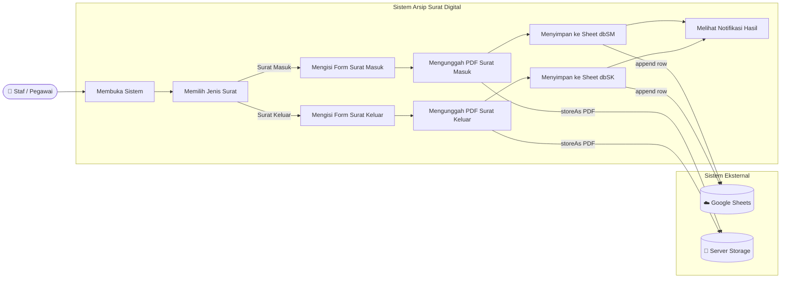
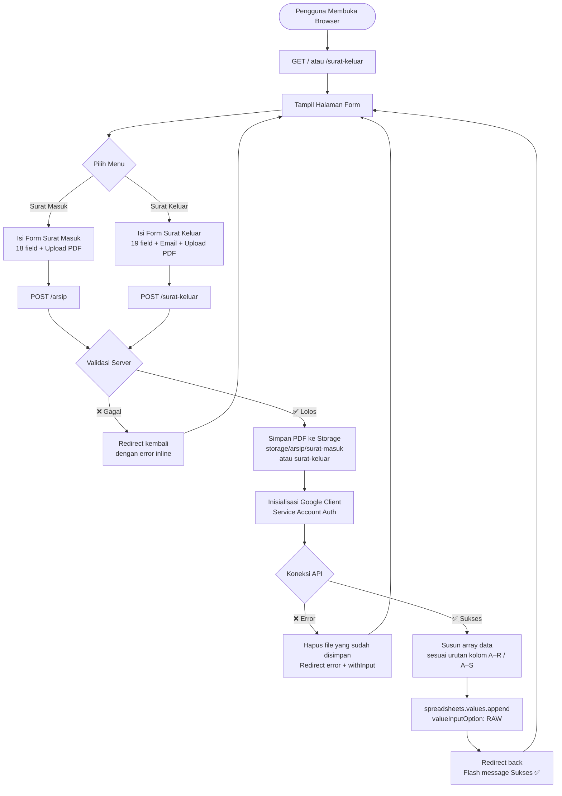
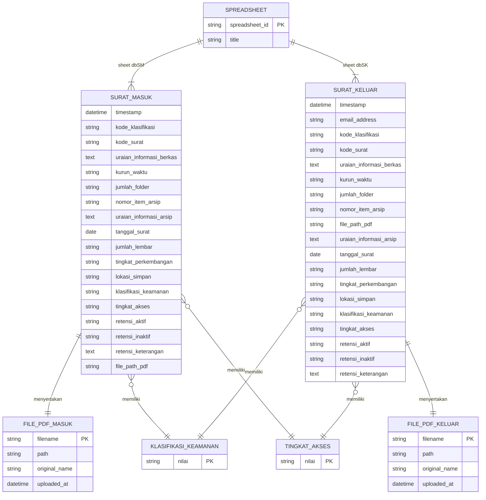

# 📂 Sistem Arsip Surat Digital — BPSDMP

Aplikasi web pengarsipan surat digital untuk **Balai Pengembangan Sumber Daya Manusia dan Penelitian (BPSDMP) Kominfo Manado**, dibangun dengan Laravel dan terintegrasi langsung dengan **Google Sheets** sebagai database utama.

---

## 📋 Deskripsi Proyek

Sistem ini menggantikan pencatatan arsip surat manual dengan formulir digital yang mengirimkan data secara otomatis ke Google Spreadsheet. Setiap surat masuk maupun keluar dicatat lengkap beserta file PDF-nya, timestamp otomatis, dan informasi kearsipan standar.

**Spreadsheet target:** `ARSIP SURAT BPSDMP KOMINFO MANADO`

| Sheet | Fungsi | Kolom |
|---|---|---|
| `dbSM` | Surat Masuk | A – R (18 kolom) |
| `dbSK` | Surat Keluar | A – S (19 kolom) |

---

## ⚙️ Tech Stack

| Layer | Teknologi |
|---|---|
| Framework | Laravel 13 (PHP 8.4) |
| Database Utama | Google Sheets (via Service Account API) |
| Database Lokal | SQLite (session, cache) |
| Storage File | Laravel Storage (`storage/app/public/arsip/`) |
| Styling | Custom CSS Design System (tanpa Bootstrap/Tailwind) |
| Font | Inter (Google Fonts) |
| API Client | `google/apiclient` |

---

## ✨ Fitur Utama

- **Dual form** — Input Surat Masuk & Surat Keluar dengan sidebar navigasi
- **Upload PDF wajib** — Setiap surat wajib menyertakan file PDF (maks. 10 MB) dengan drag-and-drop support
- **Auto-timestamp** — Waktu pengisian diisi otomatis oleh server
- **Validasi server-side** — 17–18 aturan validasi per form, error ditampilkan inline
- **Integrasi real-time** — Data langsung dikirim ke Google Sheets saat submit
- **Responsive** — 5 breakpoint (1024px / 768px / 640px / 480px / 360px)
- **Scroll reveal** — Animasi kartu form saat scroll dengan IntersectionObserver
- **Auto-hide header** — Header menyembunyikan diri saat scroll ke bawah

---

## 📁 Struktur Direktori

```
project/
├── app/Http/Controllers/
│   ├── ArsipController.php          # Handler surat masuk (dbSM)
│   └── SuratKeluarController.php    # Handler surat keluar (dbSK)
├── resources/views/
│   ├── layouts/app.blade.php        # Layout utama + sidebar
│   ├── arsip/index.blade.php        # Form surat masuk
│   └── surat-keluar/index.blade.php # Form surat keluar
├── public/css/app.css               # Design system kustom
├── routes/web.php                   # Definisi route
├── storage/app/public/arsip/
│   ├── surat-masuk/                 # PDF surat masuk tersimpan
│   └── surat-keluar/               # PDF surat keluar tersimpan
└── storage/app/
    └── google-credentials.json      # Service Account key (jangan di-commit)
```

---

## 🚀 Instalasi

```bash
# 1. Clone repositori
git clone <repo-url>
cd <nama-folder>

# 2. Install dependency PHP
composer install

# 3. Salin file environment
cp .env.example .env
php artisan key:generate

# 4. Jalankan migrasi (SQLite untuk session/cache)
php artisan migrate

# 5. Buat symlink storage
php artisan storage:link

# 6. Buat folder arsip
mkdir -p storage/app/public/arsip/surat-masuk
mkdir -p storage/app/public/arsip/surat-keluar

# 7. Jalankan server
php artisan serve
```

---

## 🔧 Konfigurasi Google Sheets

### 1. Buat Service Account
1. Buka [Google Cloud Console](https://console.cloud.google.com/)
2. Buat project baru → aktifkan **Google Sheets API**
3. Buat **Service Account** → unduh file JSON credentials
4. Simpan file JSON ke `storage/app/google-credentials.json`

### 2. Bagikan Spreadsheet
Tambahkan email service account sebagai **Editor** di spreadsheet target:
```
contoh: nama-akun@project-id.iam.gserviceaccount.com
```

> ⚠️ Jika sheet memiliki **proteksi range**, tambahkan email service account ke daftar editor proteksi tersebut.

### 3. Isi file `.env`
```env
GOOGLE_SHEET_ID=<ID spreadsheet dari URL>
GOOGLE_SERVICE_ACCOUNT_JSON=storage/app/google-credentials.json
```

---

## 📊 Diagram

### Use Case Diagram



---

### Flowchart — Alur Proses Input Surat



---

### Entity Relationship Diagram (ERD)

> Karena sistem menggunakan Google Sheets sebagai database, ERD merepresentasikan struktur data virtual dua sheet utama beserta relasinya terhadap penyimpanan file lokal.



---

## 📑 Struktur Data

### Sheet `dbSM` — Surat Masuk (18 Kolom, A–R)

| Kolom | Nama Field | Tipe | Wajib |
|---|---|---|---|
| A | Timestamp | `datetime` | Auto |
| B | Kode Klasifikasi | `string` | ✅ |
| C | Kode Surat | `string` | ✅ |
| D | Uraian Informasi Berkas | `text` | ✅ |
| E | Kurun Waktu | `string` | — |
| F | Jumlah Folder | `string` | — |
| G | Nomor: Item Arsip | `string` | — |
| H | Uraian Informasi Arsip | `text` | — |
| I | Tanggal Surat | `date` | ✅ |
| J | Jumlah Lembar | `string` | — |
| K | Tingkat Perkembangan | `string` | — |
| L | Lokasi Simpan | `string` | — |
| M | Klasifikasi Keamanan | `enum` | — |
| N | Tingkat Akses | `enum` | — |
| O | Retensi "Aktif" | `string` | — |
| P | Retensi "Inaktif" | `string` | — |
| Q | Retensi "Keterangan" | `text` | — |
| R | Surat Masuk (PDF) | `string` (path) | ✅ |

### Sheet `dbSK` — Surat Keluar (19 Kolom, A–S)

| Kolom | Nama Field | Tipe | Wajib |
|---|---|---|---|
| A | Timestamp | `datetime` | Auto |
| B | Email Address | `email` | ✅ |
| C | Kode Klasifikasi | `string` | ✅ |
| D | Kode Surat | `string` | ✅ |
| E | Uraian Informasi Berkas | `text` | ✅ |
| F | Kurun Waktu | `string` | — |
| G | Jumlah Folder | `string` | — |
| H | Nomor: Item Arsip | `string` | — |
| I | Surat Keluar (PDF) | `string` (path) | ✅ |
| J | Uraian Informasi Arsip | `text` | — |
| K | Tanggal Surat | `date` | ✅ |
| L | Jumlah Lembar | `string` | — |
| M | Tingkat Perkembangan | `string` | — |
| N | Lokasi Simpan | `string` | — |
| O | Klasifikasi Keamanan | `enum` | — |
| P | Tingkat Akses | `enum` | — |
| Q | Retensi "Aktif" | `string` | — |
| R | Retensi "Inaktif" | `string` | — |
| S | Retensi "Keterangan" | `text` | — |

**Nilai Enum:**

| Field | Pilihan |
|---|---|
| Klasifikasi Keamanan | `Biasa` · `Terbatas` · `Rahasia` · `Sangat Rahasia` |
| Tingkat Akses | `Terbuka` · `Tertutup` · `Terbatas` |

---

## 📝 Catatan Teknis

### Autoloader Google API
Paket `google/apiclient-services` memiliki 300+ service. Untuk mempercepat `composer dump-autoload`, proyek ini hanya meng-include service **Sheets**:

```json
"extra": {
    "google/apiclient-services": ["Sheets"]
},
"scripts": {
    "pre-autoload-dump": "Google\\Task\\Composer::cleanup"
}
```

### Penamaan File PDF
File disimpan dengan format: `YYYYMMDD_HHmmss_nama-file-original.pdf`

```
Contoh: 20250509_143022_surat-keputusan.pdf
```

### Proteksi Sheet Google Sheets
Jika sheet memiliki range yang diproteksi, service account **harus** ditambahkan sebagai editor di pengaturan proteksi tersebut secara manual oleh pemilik spreadsheet. Proteksi tidak dapat diubah melalui API jika service account bukan pemilik file.

---

## 📄 Lisensi

Proyek ini dikembangkan untuk keperluan internal **BPSDMP Kominfo Manado**.
