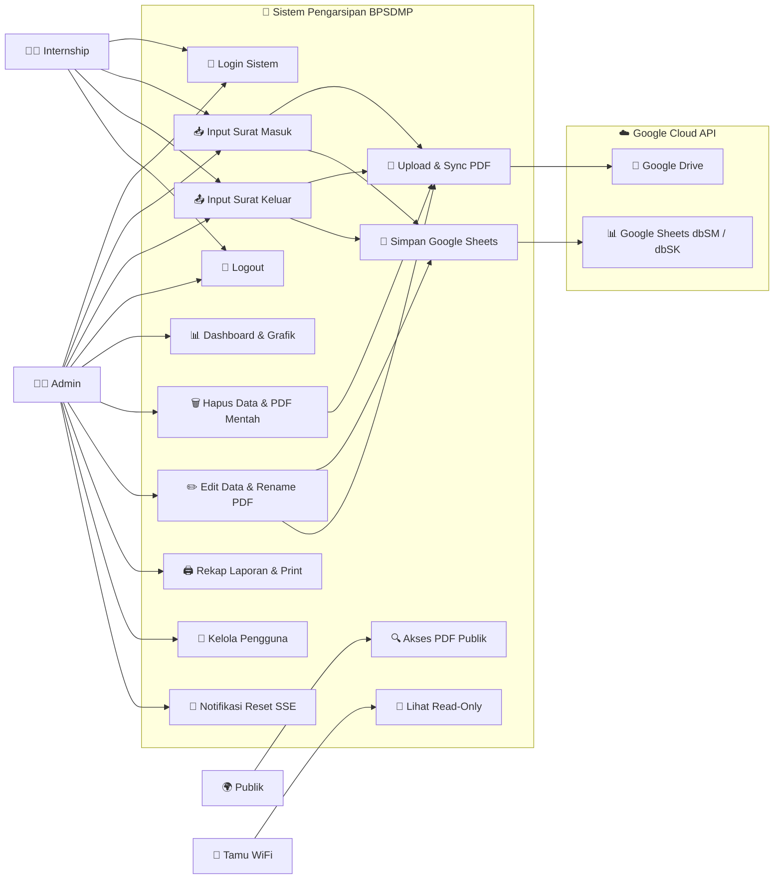
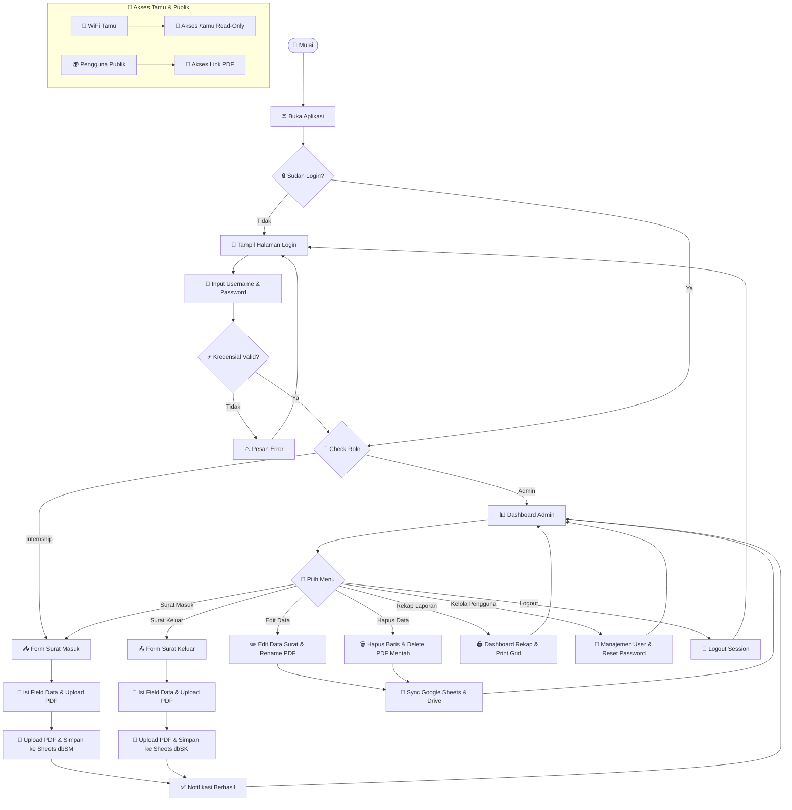
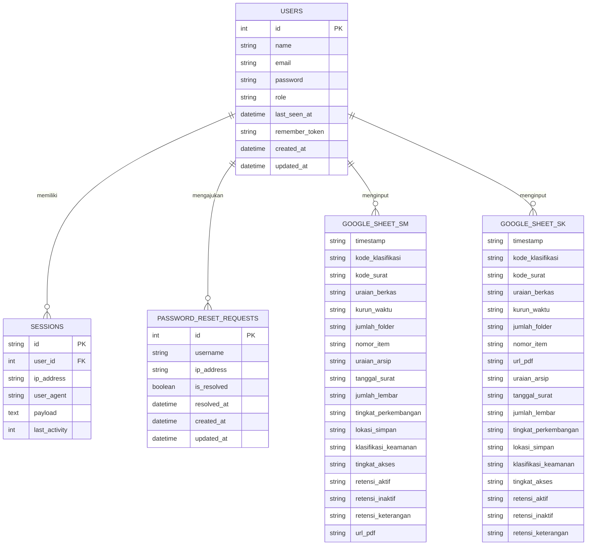

# 📂 Sistem Pengarsipan Digital Surat — BPSDMP

Aplikasi web berbasis **Laravel 13** untuk pengarsipan surat masuk dan surat keluar secara digital. Data arsip disimpan secara aman ke **Google Spreadsheet** via Google Sheets API v4, dan file PDF fisik dikelola secara sinkron di server lokal (`/uploads`) serta **Google Drive API**.

---

## ⚡ Quick Start — Setup Awal & Jalankan Aplikasi

Setelah melakukan `git clone` pada PC server khusus, Anda dapat mengelola jalannya aplikasi menggunakan skrip otomatisasi berikut:

### 📥 1. Inisialisasi Pertama Kali (Setup)
Jalankan file berikut **hanya pada saat instalasi pertama kali** di server:
```cmd
setup-and-run.bat
```
Skrip ini memerlukan hak akses **Administrator** untuk melakukan konfigurasi otomatis:
- 🔑 **UAC Elevation** — Meminta akses Administrator Windows otomatis.
- ⚡ **Service Laragon** — Menyalakan dan mengaktifkan Apache & MySQL di Laragon.
- 📝 **Environment** — Membuat berkas `.env` jika belum ada & mengisi parameter default.
- 🗄️ **Database** — Membuat database `arsip_bpsdmp` dan menjalankan migrasi database.
- 🌐 **Virtual Host** — Membuat VirtualHost Apache `kearsipan.local.conf` di Laragon.
- 📌 **Hosts File** — Mendaftarkan domain `127.0.0.1 kearsipan.local` di berkas `hosts` Windows.
- 🛡️ **Firewall** — Membuka Inbound Port 80 pada Windows Firewall.
- 🧹 **Storage & Cache** — Melakukan pembersihan berkas temporary views & cache framework data.

### 🚀 2. Menjalankan Aplikasi Sehari-hari (Daily Runner)
Untuk penggunaan sehari-hari setelah setup awal berhasil, **jangan** menjalankan skrip setup di atas. Gunakan skrip berikut yang jauh lebih ringan, cepat, dan aman:
```cmd
start-all.bat
```
Skrip runner ini **tidak membutuhkan hak Administrator** dan akan melakukan:
- ⚡ **Service Check** — Memastikan Laragon, Apache, dan MySQL sudah aktif.
- ⚙️ **Queue Worker** — Menyalakan Laravel Queue Worker di latar belakang jika belum aktif.
- 🕔 **Task Scheduler** — Menyalakan Laravel Scheduler di latar belakang jika belum aktif (otomatis menjalankan pembersihan storage setiap pukul **17:00**).
- 🌐 **Auto-Launch** — Membuka browser langsung ke URL login aplikasi.

### 🌐 3. Akses Aplikasi & Kredensial Login
- **Akses Staff / Admin**: `http://kearsipan.local/`
- **Akses WiFi Tamu (Read-Only)**: `http://kearsipan.local/tamu`

| Peran | Username / Email | Password Default |
|---|---|---|
| **Admin** | `Admin` atau `admin@bpsdmp.go.id` | `admin_BPSDMP26` |
| **Internship** | `Internship` atau `internship@bpsdmp.go.id` | `internship_BPSDMP` |

---

## 🚀 Fitur Utama

| Fitur | Deskripsi |
|---|---|
| 🔐 **Autentikasi & RBAC** | Login aman dengan multi-role: `admin` & `internship` |
| 📥 **Surat Masuk** | Input data lengkap + upload PDF, tersimpan ke Google Sheets (`dbSM`) |
| 📤 **Surat Keluar** | Input data lengkap + upload PDF, tersimpan ke Google Sheets (`dbSK`) |
| ✏️ **Edit & Rename PDF** | Edit data surat otomatis mengubah nama file PDF mentah di lokal (`/uploads`) & Google Drive |
| 🗑️ **Hapus Synchronous** | Hapus data surat otomatis menghapus file PDF mentah dari lokal (`/uploads`) & Google Drive |
| 🔍 **Filter & Klasifikasi** | Pencarian & filter presisi berdasarkan kode klasifikasi surat |
| 📊 **Dashboard & Grafik Bar** | Statistik data arsip bulanan, tahunan, & angka total tepat di atas batang grafik |
| 🖨️ **Laporan Rekap Printable** | Tampilan cetak profesional dengan kisi garis seragam (`1pt solid #333`) & Uraian Informasi Arsip |
| 👥 **Manajemen Pengguna** | Admin dapat mereset password internship & menindaklanjuti permintaan reset |
| 🔔 **Notifikasi Realtime (SSE)** | Admin mendapat notifikasi realtime saat internship mengajukan reset password |
| 🌐 **Intranet Speed & Smooth Nav** | Loading animation kontekstual & font fallback sistem lokal untuk navigasi instan di Intranet WiFi |
| 👀 **Mode Tamu (Read-Only)** | Halaman khusus WiFi tamu tanpa login untuk membaca data arsip |
| 🔒 **Cybersecurity Layer** | Proteksi Formula Injection, CSP, Rate Limiting, & Session Protection |
| 🧹 **Task Scheduler** | Pembersihan otomatis file temporary setiap tengah malam |

---

## 🛠️ Tech Stack

| Lapisan | Teknologi |
|---|---|
| **Framework** | Laravel 13 (PHP 8.3+) |
| **Database** | MySQL / MariaDB (autentikasi & session) |
| **Penyimpanan Data** | Google Sheets API v4 (`dbSM` & `dbSK`) |
| **Penyimpanan File** | Server Lokal (`/uploads`) + Google Drive API |
| **Frontend** | Blade Templates + Vanilla CSS (Dark Mode) + Chart.js |
| **Web Server** | Apache via Laragon — Virtual Host `kearsipan.local` |
| **Real-time** | Server-Sent Events (SSE) untuk notifikasi reset password |

---

## 👥 Peran & Hak Akses

| Kemampuan | Admin | Internship | Tamu (WiFi) | Publik |
|---|:---:|:---:|:---:|:---:|
| Login | ✅ | ✅ | ❌ | ❌ |
| Input Surat Masuk | ✅ | ✅ | ❌ | ❌ |
| Input Surat Keluar | ✅ | ✅ | ❌ | ❌ |
| Edit Data & Rename PDF | ✅ | ❌ | ❌ | ❌ |
| Hapus Data & Hapus PDF | ✅ | ❌ | ❌ | ❌ |
| Dashboard & Rekap | ✅ | ❌ | ❌ | ❌ |
| Kelola Pengguna | ✅ | ❌ | ❌ | ❌ |
| Lihat Arsip (Read-Only) | ✅ | ✅ | ✅ | ❌ |
| Akses PDF Publik | ✅ | ✅ | ✅ | ✅ |

---

## 🗺️ Peta Rute (Routes)

### Publik
| Method | URL | Keterangan |
|---|---|---|
| `GET` | `/login` | Halaman login |
| `POST` | `/login` | Proses login *(Rate Limiting terkelola)* |
| `POST` | `/logout` | Proses logout |
| `POST` | `/password/request-reset` | Ajukan permintaan reset password *(throttle: 3 req/5 menit)* |
| `GET` | `/pdf/{type}/{filename}` | Akses file PDF publik |
| `GET` | `/image/{filename}` | Akses file gambar publik |

### Terautentikasi (Admin & Internship)
| Method | URL | Keterangan |
|---|---|---|
| `GET` | `/` | Daftar Surat Masuk |
| `POST` | `/arsip` | Simpan Surat Masuk baru |
| `GET` | `/surat-keluar` | Daftar Surat Keluar |
| `POST` | `/surat-keluar` | Simpan Surat Keluar baru |

### Admin Only
| Method | URL | Keterangan |
|---|---|---|
| `GET` | `/dashboard` | Dashboard & statistik grafik |
| `GET` | `/dashboard/report` | Rekap laporan (printable) |
| `GET` | `/arsip/{rowIndex}/edit` | Form edit Surat Masuk |
| `PUT` | `/arsip/{rowIndex}` | Update Surat Masuk + Rename PDF |
| `DELETE` | `/arsip/{rowIndex}` | Hapus Surat Masuk + Hapus PDF |
| `GET` | `/surat-keluar/{rowIndex}/edit` | Form edit Surat Keluar |
| `PUT` | `/surat-keluar/{rowIndex}` | Update Surat Keluar + Rename PDF |
| `DELETE` | `/surat-keluar/{rowIndex}` | Hapus Surat Keluar + Hapus PDF |
| `GET` | `/admin/users` | Kelola pengguna |
| `POST` | `/admin/users/{user}/reset-password` | Reset password pengguna |
| `POST` | `/admin/password-reset-requests/{id}/resolve` | Tandai permintaan reset selesai |
| `GET` | `/sse/reset-requests` | Stream SSE notifikasi reset password |
| `GET` | `/api/reset-requests-version` | Polling fallback versi permintaan reset |

### Tamu WiFi (Read-Only, Tanpa Login)
| Method | URL | Keterangan |
|---|---|---|
| `GET` | `/tamu` | Daftar Surat Masuk (read-only) |
| `GET` | `/tamu/surat-keluar` | Daftar Surat Keluar (read-only) |

---

## 👤 Use Case Diagram



---

## 🔄 Flowchart Sistem



---

## 📐 Entity Relationship Diagram (ERD)



---

## 🔒 Keamanan (Security Layer)

Aplikasi dilengkapi dengan beberapa lapisan keamanan:

| Middleware | Fungsi |
|---|---|
| `AdminOnly` | Membatasi akses rute hanya untuk role `admin` |
| `InternalNetworkOnly` | Membatasi akses input/write hanya dari subnet jaringan internal |
| `GuestNetwork` | Membatasi `/tamu` agar hanya bisa diakses dari subnet tamu atau internal |
| `SecurityHeaders` | Menambahkan HTTP headers: CSP, X-Frame-Options, X-Content-Type-Options, dll. |
| `UpdateUserLastSeen` | Mencatat waktu terakhir user aktif (`last_seen_at`) |
| **Rate Limiting** | Login terkelola per IP & username; Reset Password: maks 3 req/5 menit |
| **Formula Injection** | Sanitasi input spreadsheet untuk mencegah CSV/formula injection |
| **Session Protection** | Enkripsi session, expire on close, SameSite cookie |

---

## ⚙️ Konfigurasi Environment (`.env`)

Salin `.env.example` ke `.env` dan sesuaikan nilai berikut:

```env
# Aplikasi
APP_NAME="Arsip Surat BPSDMP"
APP_URL=http://kearsipan.local
APP_TIMEZONE=Asia/Makassar

# Kontrol Jaringan Intranet
INTRANET_ENABLED=true
INTERNAL_NETWORK_SUBNET=192.168.252.0/22   # Subnet staff/admin
GUEST_NETWORK_SUBNET=10.0.0.0/24           # Subnet tamu (read-only)

# Google API
GOOGLE_SHEET_ID=<id-spreadsheet-anda>
GOOGLE_SERVICE_ACCOUNT_JSON=storage/app/google-credentials.json
GOOGLE_DRIVE_FOLDER_ID=<id-folder-drive-anda>

# Database MySQL
DB_DATABASE=arsip_bpsdmp
DB_USERNAME=root
DB_PASSWORD=
```

> **Catatan**: Letakkan file `google-credentials.json` (Service Account key) di `storage/app/`.

---

## 🔒 Pemeliharaan & Jadwal Otomatis (Scheduler)

Aplikasi dilengkapi dengan **Laravel Task Scheduler** yang berjalan setiap hari pukul **17:00 (5 Sore)** untuk membersihkan berkas-berkas temporary secara otomatis:

- `storage/framework/views` — Compiled Blade Views
- `storage/framework/sessions` — File Session Usang
- `storage/framework/cache/data` — Subfolder Cache Data

Scheduler dijalankan secara otomatis oleh [`start-all.bat`](file:///c:/laragon/www/project-magang/start-all.bat) menggunakan `php artisan schedule:work` di background. Log eksekusi scheduler tersimpan di `storage/logs/scheduler.log`.

Pembersihan manual dapat dilakukan kapan saja via terminal:
```bash
php artisan storage:clean
```

---

## 📁 Struktur Direktori Penting

```
project-magang/
├── app/
│   ├── Http/
│   │   ├── Controllers/
│   │   │   ├── Admin/UserController.php        # Kelola pengguna & reset password + SSE
│   │   │   ├── Auth/LoginController.php         # Login & logout
│   │   │   ├── Auth/PasswordResetController.php # Permintaan reset password
│   │   │   ├── ArsipController.php              # CRUD Surat Masuk
│   │   │   ├── SuratKeluarController.php        # CRUD Surat Keluar
│   │   │   ├── DashboardController.php          # Dashboard & rekap laporan
│   │   │   └── Controller.php                   # Base controller: KODE_MAP, getSheetService, escapeFormula, dll.
│   │   └── Middleware/
│   │       ├── AdminOnly.php
│   │       ├── InternalNetworkOnly.php
│   │       ├── GuestNetwork.php
│   │       ├── SecurityHeaders.php
│   │       ├── UpdateUserLastSeen.php
│   │       └── Concerns/
│   │           └── ChecksIpSubnet.php           # Trait bersama: validasi IP subnet CIDR (IPv4 & IPv6)
│   ├── Models/
│   │   ├── User.php
│   │   └── PasswordResetRequest.php
│   └── Services/
│       ├── GoogleDriveService.php               # Upload, rename, & delete di Google Drive & /uploads
│       └── SheetsCache.php                      # Cache data Google Sheets
├── database/
│   ├── migrations/                              # Skema tabel MySQL
│   └── seeders/                                 # Data awal (user default)
├── routes/
│   ├── web.php                                  # Definisi semua rute web
│   └── console.php                              # Task scheduler (storage:clean)
├── storage/app/
│   └── google-credentials.json                  # (tidak di-commit) Service Account key
├── uploads/                                     # File PDF yang diupload
├── setup-and-run.bat                            # Skrip setup 1-Pintu (Windows)
└── start-all.bat                                # Skrip jalankan ulang (Windows)
```

---

## 🔧 Optimalisasi & Refaktor (Changelog Teknis)

| # | Perubahan | File |
|---|---|---|
| 1 | Konsolidasikan `KODE_KLASIFIKASI_ORDER`, `KODE_MAP`, `sortByKlasifikasi()`, `applyKodeMapFallback()`, `getSheetService()`, `escapeFormula()` ke base `Controller.php` | `Controller.php` |
| 2 | Tambahkan `GoogleDriveService::renameFile()` → ubah nama PDF di `/uploads` & Google Drive saat Edit | `GoogleDriveService.php` |
| 3 | Tambahkan `GoogleDriveService::deleteFile()` → hapus PDF fisik di `/uploads` & Google Drive saat Destroy | `GoogleDriveService.php` |
| 4 | Tambahkan plugin datalabels pada Chart.js → angka total tampil di atas batang grafik | `dashboard/index.blade.php` |
| 5 | Standardisasi loading animation kontekstual & font fallback sistem untuk navigasi Intranet WiFi instan | `layouts/app.blade.php`, `tamu/index.blade.php` |
| 6 | Penyeragaman kisi garis tabel cetak (`1pt solid #333`), header *URAIAN INFORMASI ARSIP*, hapus kolom Tahun & tanda tangan | `dashboard/report.blade.php` |
| 7 | Trait `ChecksIpSubnet` → penanganan subnet IPv4 & IPv6 yang aman tanpa exception | `Concerns/ChecksIpSubnet.php` |
| 8 | Perbaikan keamanan database seeder → menghapus truncate user tabel agar user kustom persisten | `DatabaseSeeder.php` |
| 9 | Pemisahan skrip startup harian `start-all.bat` dari skrip inisialisasi awal `setup-and-run.bat` | `start-all.bat`, `setup-and-run.bat` |
| 10 | Penyesuaian parameter host header Ngrok agar sesuai dengan virtual host `kearsipan.local` | `start-ngrok.bat` |
| 11 | Aktifkan Task Scheduler `storage:clean` otomatis setiap pukul **17:00** dengan logging ke `storage/logs/scheduler.log` | `routes/console.php` |
| 12 | Tambahkan spawn `schedule:work` di background pada runner harian agar scheduler aktif tanpa intervensi manual | `start-all.bat` |

---

## 📄 Lisensi

Proyek ini dikembangkan sebagai bagian dari **program magang** di **BPSDMP** dan bersifat internal.
