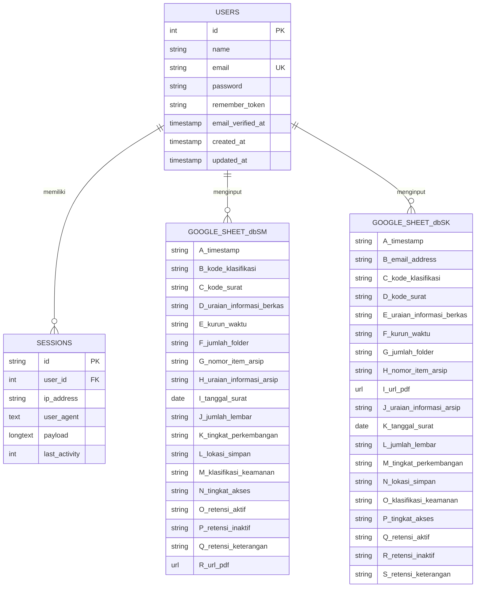
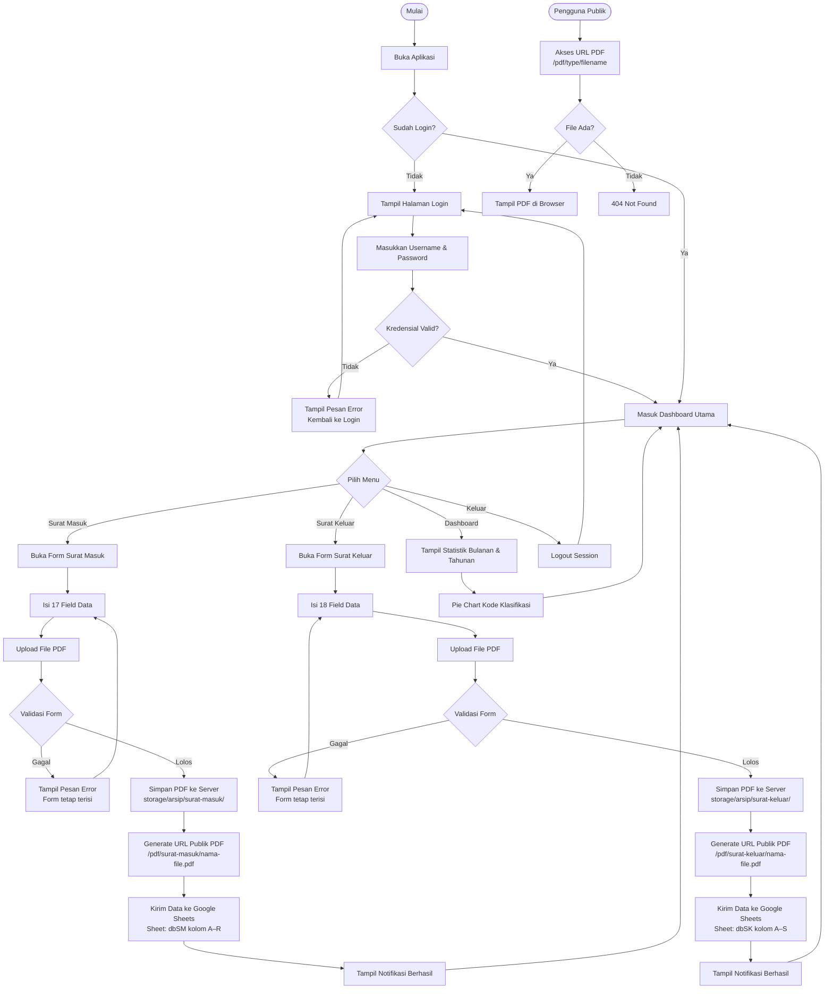
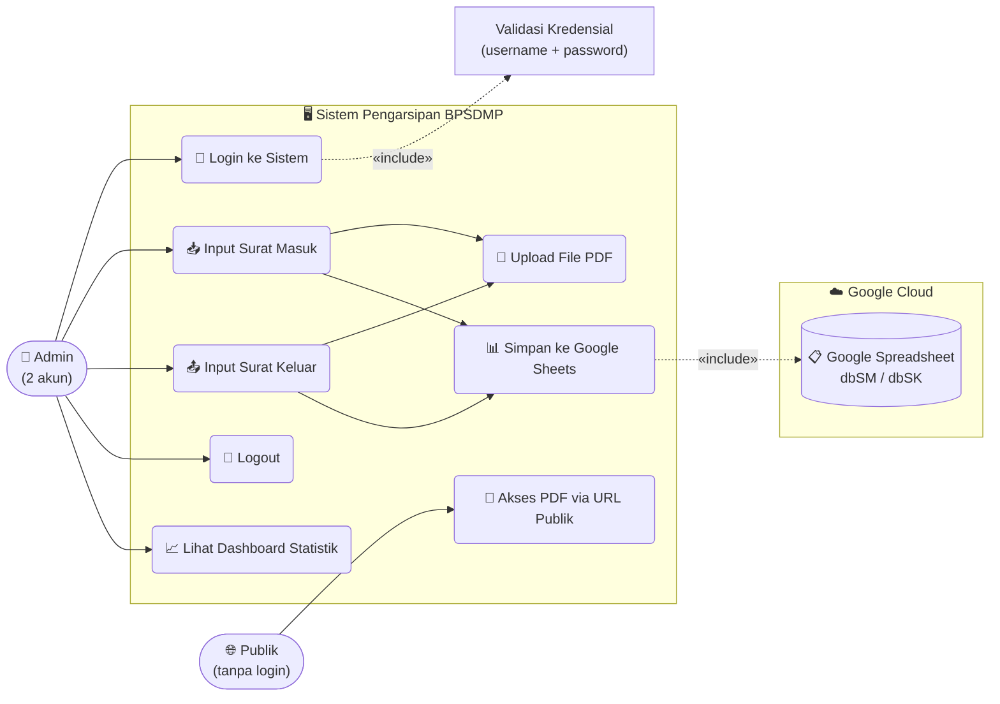

# 📂 Sistem Pengarsipan Digital Surat — BPSDMP

Aplikasi web berbasis **Laravel 11** untuk pengarsipan surat masuk dan surat keluar secara digital. Data arsip disimpan langsung ke **Google Spreadsheet** via Google Sheets API, file PDF disimpan di server lokal dan dapat **diakses publik** melalui URL unik tanpa perlu login.

---

## 🚀 Fitur Utama

- 🔐 **Autentikasi** — Login berbasis username & password, hanya 2 akun admin yang berwenang
- 📥 **Arsip Surat Masuk** — Input 17 field data + upload file PDF (maks. 10MB)
- 📤 **Arsip Surat Keluar** — Input 18 field data + upload file PDF (maks. 10MB)
- 📊 **Google Sheets Integration** — Data tersimpan otomatis ke spreadsheet (sheet `dbSM` dan `dbSK`)
- 📎 **PDF Publik** — File PDF surat dapat diakses publik via URL `/pdf/{type}/{filename}` tanpa login
- 📈 **Dashboard Rangkuman** — Statistik bulanan & tahunan surat masuk/keluar + pie chart kode klasifikasi
- 📱 **Responsive** — Hamburger menu untuk tampilan mobile & tablet
- 🌐 **Ngrok Ready** — Trusted proxy dikonfigurasi agar bekerja lewat tunnel HTTPS
- ⚡ **Apache Ready** — Virtual host Laragon dikonfigurasi, tidak perlu `php artisan serve`

---

## 🛠️ Tech Stack

| Layer | Teknologi |
|---|---|
| Framework | Laravel 11 (PHP 8.4) |
| Database | SQLite (local auth & sessions) |
| Storage | Google Sheets API v4 |
| Frontend | Blade + Vanilla CSS (Pure CSS, tanpa framework) |
| Auth | Laravel Session Auth (`Auth::attempt`) |
| File Upload | Laravel Storage (`public` disk) |
| Web Server | Apache (Laragon) — port 80, virtual host `project-magang.test` |
| Tunnel | Ngrok (opsional, untuk akses publik via PC lokal) |

---

## 🌐 Akses PDF Publik

File PDF yang diupload dapat diakses **tanpa login** melalui URL:

```
https://domain-kamu.com/pdf/surat-masuk/{nama-file.pdf}
https://domain-kamu.com/pdf/surat-keluar/{nama-file.pdf}
```

- URL ini tersimpan otomatis di kolom **R (Surat Masuk)** dan **I (Surat Keluar)** di Google Sheets
- Dapat langsung diklik dari spreadsheet untuk membuka/mengunduh PDF
- Keamanan: hanya ekstensi `.pdf` yang diizinkan, path traversal dicegah

---

## ⚡ Cara Menjalankan Lokal (Laragon)

> Tidak perlu `php artisan serve` — langsung menggunakan Apache Laragon.

### Prasyarat
- Laragon terinstall & Apache **berjalan** (`Start All`)
- PHP 8.4 dengan extension `pdo_sqlite` & `sqlite3` aktif di `php.ini`
- Virtual host `project-magang.test` terkonfigurasi

### Langkah Setup Awal (sekali saja)
```bash
# 1. Clone project
cd C:\laragon\www
# (letakkan folder project-magang di sini)

# 2. Install dependencies
composer install

# 3. Buat file .env
cp .env.example .env
php artisan key:generate

# 4. Isi konfigurasi .env (lihat bagian Konfigurasi .env)

# 5. Migrasi & seed database
php artisan migrate --seed

# 6. Buat symlink storage
php artisan storage:link
```

### Menjalankan Sehari-hari
1. Pastikan **Laragon** aktif (Apache menyala)
2. Akses lokal: `http://project-magang.test`
3. Untuk akses publik via ngrok, **double-click** `start-ngrok.bat`

---

## 🔧 Konfigurasi `.env`

```dotenv
APP_NAME="Arsip Surat BPSDMP"
APP_ENV=local
APP_KEY=base64:...
APP_DEBUG=true
APP_URL=http://project-magang.test

GOOGLE_SHEET_ID=1QdlmA0ug3xNY2-...
GOOGLE_SERVICE_ACCOUNT_JSON=storage/app/google-credentials.json

DB_CONNECTION=sqlite
```

---

## 📐 Entity Relationship Diagram (ERD)

> Tabel `users` digunakan hanya untuk autentikasi. Data arsip surat disimpan di Google Sheets, bukan di database lokal.



---

## 🔄 Flowchart Sistem



---

## 👤 Use Case Diagram



---

## 🗂️ Struktur Direktori Penting

```
project-magang/
├── app/
│   └── Http/
│       └── Controllers/
│           ├── ArsipController.php          ← Surat Masuk (form + Google Sheets + URL PDF)
│           ├── SuratKeluarController.php    ← Surat Keluar (form + Google Sheets + URL PDF)
│           ├── DashboardController.php      ← Statistik bulanan/tahunan dari Google Sheets
│           └── Auth/
│               └── LoginController.php      ← Login & Logout
├── bootstrap/
│   └── app.php                              ← TrustProxies untuk Ngrok (at: '*')
├── database/
│   ├── migrations/                          ← Tabel users, sessions, cache
│   ├── seeders/
│   │   └── DatabaseSeeder.php               ← 2 akun admin hardcoded
│   └── database.sqlite                      ← Database lokal (SQLite)
├── public/
│   ├── css/
│   │   └── app.css                          ← Stylesheet utama (Vanilla CSS)
│   └── storage/                             ← Symlink ke storage/app/public/
├── resources/
│   └── views/
│       ├── auth/
│       │   └── login.blade.php              ← Halaman login (dark glassmorphism)
│       ├── arsip/
│       │   └── index.blade.php              ← Form surat masuk
│       ├── surat-keluar/
│       │   └── index.blade.php              ← Form surat keluar
│       ├── dashboard/
│       │   └── index.blade.php              ← Dashboard statistik & chart
│       └── layouts/
│           └── app.blade.php                ← Layout utama (sidebar + header)
├── routes/
│   └── web.php                              ← Semua route (auth middleware + PDF publik)
├── storage/
│   └── app/public/
│       ├── arsip/surat-masuk/               ← PDF surat masuk tersimpan di sini
│       └── arsip/surat-keluar/              ← PDF surat keluar tersimpan di sini
├── start-ngrok.bat                          ← Script 1-klik untuk jalankan ngrok
└── C:\laragon\etc\apache2\sites-enabled\
    └── auto.project-magang.test.conf        ← Virtual host Apache Laragon
```

---

## 🔑 Akun Admin

| Username | Keterangan |
|---|---|
| `admin` | Admin Utama |
| `admin2` | Admin Kedua |

> Password disimpan menggunakan **bcrypt** (Laravel `Hash::make()`). Untuk mengubah password, edit `database/seeders/DatabaseSeeder.php` lalu jalankan `php artisan db:seed --force`.

---

## 📋 Kolom Google Sheets

### Sheet `dbSM` — Surat Masuk (Kolom A–R)

| Kolom | Field |
|---|---|
| A | Timestamp |
| B | Kode Klasifikasi |
| C | Kode Surat |
| D | Uraian Informasi Berkas |
| E | Kurun Waktu |
| F | Jumlah Folder |
| G | Nomor Item Arsip |
| H | Uraian Informasi Arsip |
| I | Tanggal Surat |
| J | Jumlah Lembar |
| K | Tingkat Perkembangan |
| L | Lokasi Simpan |
| M | Klasifikasi Keamanan |
| N | Tingkat Akses |
| O | Retensi Aktif |
| P | Retensi Inaktif |
| Q | Retensi Keterangan |
| R | **URL Publik File PDF** *(dapat diklik langsung dari spreadsheet)* |

### Sheet `dbSK` — Surat Keluar (Kolom A–S)

| Kolom | Field |
|---|---|
| A | Timestamp |
| B | Email Address |
| C | Kode Klasifikasi |
| D | Kode Surat |
| E | Uraian Informasi Berkas |
| F | Kurun Waktu |
| G | Jumlah Folder |
| H | Nomor Item Arsip |
| I | **URL Publik File PDF** *(dapat diklik langsung dari spreadsheet)* |
| J | Uraian Informasi Arsip |
| K | Tanggal Surat |
| L | Jumlah Lembar |
| M | Tingkat Perkembangan |
| N | Lokasi Simpan |
| O | Klasifikasi Keamanan |
| P | Tingkat Akses |
| Q | Retensi Aktif |
| R | Retensi Inaktif |
| S | Retensi Keterangan |

---

## 🔄 Changelog Signifikan

| Versi | Perubahan |
|---|---|
| v1.0 | Setup awal: form surat masuk + keluar + Google Sheets |
| v1.1 | Sistem autentikasi login/logout (SQLite) |
| v1.2 | Responsive layout: hamburger menu mobile/tablet |
| v1.3 | Dashboard statistik bulanan & tahunan + pie chart |
| v1.4 | Apache Laragon virtual host (`project-magang.test`) — tanpa `artisan serve` |
| v1.4 | Enable PHP extensions `pdo_sqlite` & `sqlite3` untuk Apache |
| v1.5 | **PDF Publik**: Route `/pdf/{type}/{filename}` tanpa autentikasi |
| v1.5 | URL PDF lengkap tersimpan ke Google Sheets (bisa diklik dari spreadsheet) |

---

## 📜 Lisensi

Proyek ini dikembangkan untuk keperluan magang di **BPSDMP** (Balai Pengembangan Sumber Daya Manusia dan Penelitian). Tidak untuk didistribusikan secara publik.
