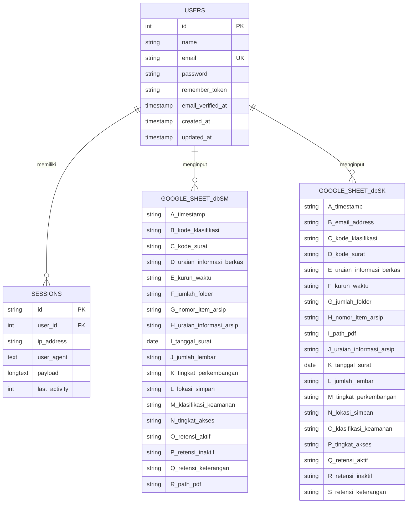
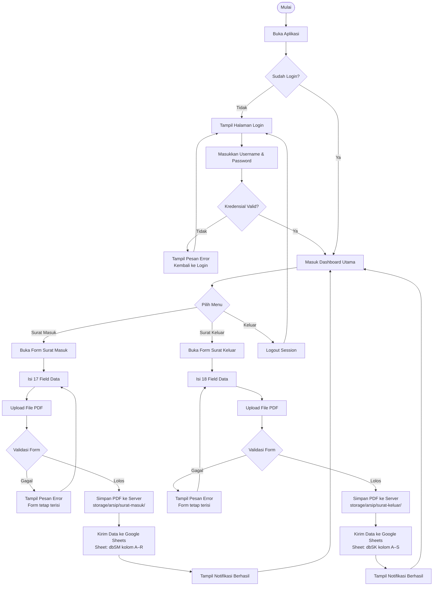
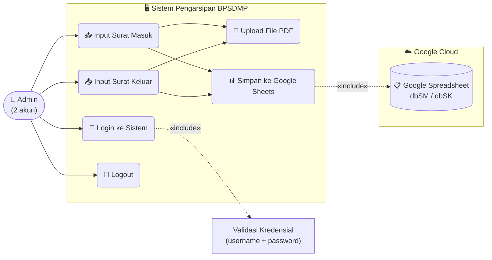

# 📂 Sistem Pengarsipan Digital Surat — BPSDMP

Aplikasi web berbasis **Laravel 11** untuk pengarsipan surat masuk dan surat keluar secara digital. Data arsip disimpan langsung ke **Google Spreadsheet** via Google Sheets API, serta file PDF surat disimpan di server lokal.

---

## 🚀 Fitur Utama

- 🔐 **Autentikasi** — Login berbasis username & password, hanya 2 akun admin yang berwenang
- 📥 **Arsip Surat Masuk** — Input 17 field data + upload file PDF (maks. 10MB)
- 📤 **Arsip Surat Keluar** — Input 18 field data + upload file PDF (maks. 10MB)
- 📊 **Google Sheets Integration** — Data tersimpan otomatis ke spreadsheet (sheet `dbSM` dan `dbSK`)
- 📱 **Responsive** — Hamburger menu untuk tampilan mobile & tablet
- 🌐 **Ngrok Ready** — Trusted proxy dikonfigurasi agar login bekerja lewat tunnel HTTPS

---

## 🛠️ Tech Stack

| Layer | Teknologi |
|---|---|
| Framework | Laravel 11 (PHP 8.4) |
| Database | SQLite (local auth) |
| Storage | Google Sheets API v4 |
| Frontend | Blade + Vanilla CSS (Pure CSS, tanpa framework) |
| Auth | Laravel Session Auth (`Auth::attempt`) |
| File Upload | Laravel Storage (`public` disk) |
| Tunnel | Ngrok (opsional, untuk akses publik) |

---

## 📐 Entity Relationship Diagram (ERD)

> Tabel `users` digunakan hanya untuk autentikasi. Data arsip surat disimpan di Google Sheets, bukan di database lokal.



---

## 🔄 Flowchart Sistem



---

## 👤 Use Case Diagram



---

## 🗂️ Struktur Direktori Penting

```
project-magang/
├── app/
│   ├── Http/
│   │   ├── Controllers/
│   │   │   ├── ArsipController.php       ← Surat Masuk (form + Google Sheets)
│   │   │   ├── SuratKeluarController.php ← Surat Keluar (form + Google Sheets)
│   │   │   └── Auth/
│   │   │       └── LoginController.php   ← Login & Logout
│   │   └── Middleware/
│   └── Models/
│       └── User.php
├── bootstrap/
│   └── app.php                           ← TrustProxies untuk Ngrok
├── database/
│   ├── migrations/                       ← Tabel users, sessions, cache
│   ├── seeders/
│   │   └── DatabaseSeeder.php            ← 2 akun admin hardcoded
│   └── database.sqlite                   ← Database lokal
├── public/
│   └── css/
│       └── app.css                       ← Stylesheet utama (Vanilla CSS, 958 baris)
├── resources/
│   └── views/
│       ├── auth/
│       │   └── login.blade.php           ← Halaman login (dark glassmorphism)
│       ├── arsip/
│       │   └── index.blade.php           ← Form surat masuk
│       ├── surat-keluar/
│       │   └── index.blade.php           ← Form surat keluar
│       └── layouts/
│           └── app.blade.php             ← Layout utama (sidebar + header)
├── routes/
│   └── web.php                           ← Semua route (auth middleware)
└── storage/
    └── app/public/
        ├── arsip/surat-masuk/            ← PDF surat masuk tersimpan di sini
        └── arsip/surat-keluar/           ← PDF surat keluar tersimpan di sini
```

---

## 🔑 Akun Admin

| Username | Keterangan |
|---|---|
| `admin` | Admin Utama |
| `admin2` | Admin Kedua |

> Password disimpan menggunakan **bcrypt** (Laravel `Hash::make()`). Untuk mengubah password, edit `database/seeders/DatabaseSeeder.php` lalu jalankan `php artisan db:seed --force`.

---

## 📋 Kolom Google Sheets

### Sheet `dbSM` — Surat Masuk (Kolom A–R)

| Kolom | Field |
|---|---|
| A | Timestamp |
| B | Kode Klasifikasi |
| C | Kode Surat |
| D | Uraian Informasi Berkas |
| E | Kurun Waktu |
| F | Jumlah Folder |
| G | Nomor Item Arsip |
| H | Uraian Informasi Arsip |
| I | Tanggal Surat |
| J | Jumlah Lembar |
| K | Tingkat Perkembangan |
| L | Lokasi Simpan |
| M | Klasifikasi Keamanan |
| N | Tingkat Akses |
| O | Retensi Aktif |
| P | Retensi Inaktif |
| Q | Retensi Keterangan |
| R | Path File PDF |

### Sheet `dbSK` — Surat Keluar (Kolom A–S)

| Kolom | Field |
|---|---|
| A | Timestamp |
| B | Email Address |
| C | Kode Klasifikasi |
| D | Kode Surat |
| E | Uraian Informasi Berkas |
| F | Kurun Waktu |
| G | Jumlah Folder |
| H | Nomor Item Arsip |
| I | Path File PDF |
| J | Uraian Informasi Arsip |
| K | Tanggal Surat |
| L | Jumlah Lembar |
| M | Tingkat Perkembangan |
| N | Lokasi Simpan |
| O | Klasifikasi Keamanan |
| P | Tingkat Akses |
| Q | Retensi Aktif |
| R | Retensi Inaktif |
| S | Retensi Keterangan |

---

## 📜 Lisensi

Proyek ini dikembangkan untuk keperluan magang di **BPSDMP** (Balai Pengembangan Sumber Daya Manusia dan Penelitian). Tidak untuk didistribusikan secara publik.
