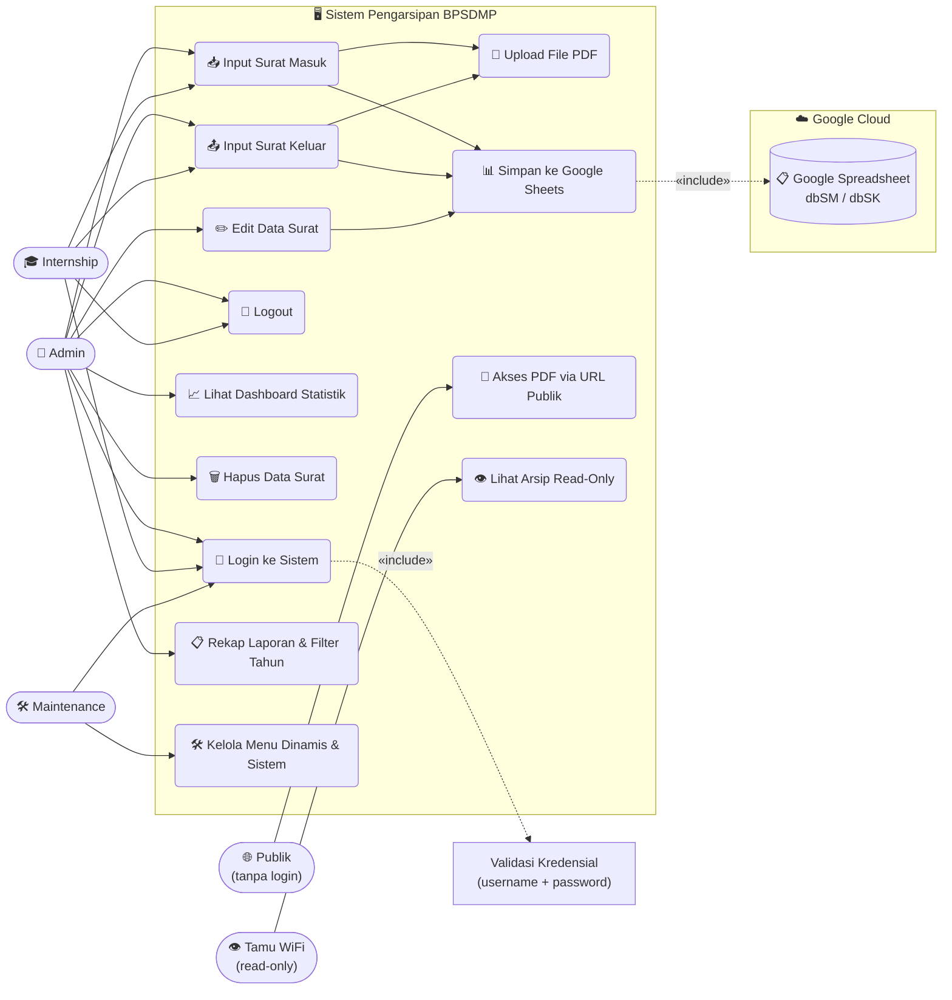
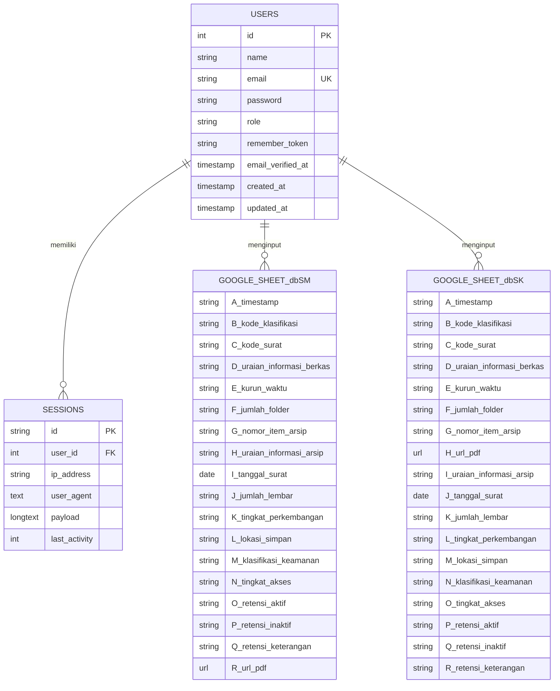

# 📂 Sistem Pengarsipan Digital Surat — BPSDMP

Aplikasi web berbasis **Laravel 13** untuk pengarsipan surat masuk dan surat keluar secara digital. Data arsip disimpan langsung ke **Google Spreadsheet** via Google Sheets API, file PDF disimpan di server lokal dan dapat diakses publik melalui URL unik.

---

## 🚀 Fitur Utama

- 🔐 **Autentikasi & RBAC** — Akses login aman dengan multi-role (Admin, Internship, Maintenance).
- 📥 **Arsip Surat Masuk & Keluar** — Input data lengkap dan upload file PDF.
- ✏️ **Edit & Hapus Data** — Pengelolaan data arsip langsung terintegrasi dengan Google Sheets.
- 🔍 **Filter & Klasifikasi** — Filter pencarian berdasarkan kode klasifikasi surat.
- 📊 **Dashboard & Rekapitulasi** — Statistik data arsip bulanan, tahunan, dan per klasifikasi.
- 🌐 **Intranet Ready** — Dapat diakses di jaringan lokal (LAN/WiFi) menggunakan domain lokal `kearsipan.local`.
- 🔒 **Cybersecurity Layer** — Proteksi terhadap Formula Injection, CSP, Rate Limiting, dan Session Protection.

---

## 🛠️ Tech Stack

- **Framework**: Laravel 13 (PHP 8.3+)
- **Database**: MySQL / MariaDB (untuk autentikasi & session)
- **Integrasi**: Google Sheets API v4 (storage utama data arsip)
- **Frontend**: Blade + Vanilla CSS (tanpa CSS framework external)
- **Web Server**: Apache (Laragon) — Virtual Host `kearsipan.local`

---

## 🌐 Akses Jaringan Lokal (WiFi / Intranet)

Aplikasi ini mendukung akses intranet menggunakan domain lokal **`kearsipan.local`**. 

### 1. Setup Virtual Host (Server)
Untuk mengarahkan domain lokal ke folder project, tambahkan konfigurasi Virtual Host pada server web Apache:
```apache
<VirtualHost *:80> 
    DocumentRoot "C:/laragon/www/project-magang/public"
    ServerName kearsipan.local
    ServerAlias *.kearsipan.local
    <Directory "C:/laragon/www/project-magang/public">
        AllowOverride All
        Require all granted
    </Directory>
</VirtualHost>
```

### 2. Resolusi Host Lokal
Tambahkan pemetaan IP ke berkas `hosts` sistem operasi server (misal: `C:\Windows\System32\drivers\etc\hosts` pada Windows):
```hosts
127.0.0.1 kearsipan.local
```

### 3. Akses Perangkat Lain di WiFi
Perangkat lain yang berada di dalam jaringan WiFi/LAN yang sama dapat mengakses aplikasi dengan:
- **DNS Kantor**: Mengarahkan domain `kearsipan.local` ke IP LAN server via DNS server lokal pada router.
- **Akses Langsung**: Mengakses menggunakan IP LAN Server secara langsung (contoh: `http://192.168.252.15/` atau `http://10.0.0.5/`). Laravel akan mendeteksi Host Header secara otomatis dan menyesuaikan seluruh tautan internal halaman.

---

## 👤 Use Case Diagram



---

## 🔄 Flowchart Sistem

```mermaid
flowchart TD
    A([Mulai]) --> B[Buka Aplikasi]
    B --> C{Sudah Login?}
    C -- Tidak --> D[Tampil Halaman Login]
    D --> E[Masukkan Username & Password]
    E --> F{Kredensial Valid?}
    F -- Tidak --> G[Tampil Pesan Error\nKembali ke Login]
    G --> D
    F -- Ya --> ROLE{Role Pengguna?}
    ROLE -- Admin --> H[Masuk Dashboard Utama]
    ROLE -- Internship --> J[Buka Form Surat Masuk]
    ROLE -- Maintenance --> MAINT[Buka Panel Maintenance]
    C -- Ya --> ROLE

    H --> I{Pilih Menu}

    I -- Surat Masuk --> J[Buka Form Surat Masuk]
    J --> K[Isi 17 Field Data]
    K --> L[Upload File PDF]
    L --> M{Validasi Form}
    M -- Gagal --> N[Tampil Pesan Error\nForm tetap terisi]
    N --> K
    M -- Lolos --> O[Upload PDF ke Google Drive\nBackup lokal ke uploads/]
    O --> P[Kirim Data ke Google Sheets\nSheet: dbSM kolom A–R]
    P --> Q[Tampil Notifikasi Berhasil]
    Q --> H

    I -- Surat Keluar --> R[Buka Form Surat Keluar]
    R --> S[Isi 18 Field Data]
    S --> T[Upload File PDF]
    T --> U{Validasi Form}
    U -- Gagal --> V[Tampil Pesan Error\nForm tetap terisi]
    V --> S
    U -- Lolos --> W[Upload PDF ke Google Drive\nBackup lokal ke uploads/]
    W --> X[Kirim Data ke Google Sheets\nSheet: dbSK kolom A–R]
    X --> Y[Tampil Notifikasi Berhasil]
    Y --> H

    I -- Dashboard --> DA[Tampil Statistik Bulanan & Tahunan]
    DA --> DB[Pie Chart Kode Klasifikasi]
    DB --> H

    I -- Hapus Data --> DEL{Konfirmasi Hapus?}
    DEL -- Ya --> DELACT[Hapus baris dari Google Sheets dbSM/dbSK]
    DELACT --> H
    DEL -- Tidak --> H

    I -- Edit Data --> EDIT[Klik tombol Edit di tabel]
    EDIT --> EDITFETCH[AJAX fetch data baris\n/arsip/{index}/edit → JSON]
    EDITFETCH --> EDITMODAL[Modal Edit pre-filled\n17 field data surat]
    EDITMODAL --> EDITSUB{Submit form PUT?}
    EDITSUB -- Ya --> EDITUPDATE[Update baris di dbSM/dbSK\nspreadsheets.values.update]
    EDITUPDATE --> H
    EDITSUB -- Tidak/Batal --> H

    I -- Rekap --> RPT[Dashboard Report]
    RPT --> RPT2[Filter Tahun per Tab\nRekap Bulanan/Tahunan/Klasifikasi]
    RPT2 --> RPT3[Cetak Tab / Cetak Semua]
    RPT3 --> H

    I -- Keluar --> Z[Logout Session]
    Z --> D

    PUB([Pengguna Publik]) --> PURL[Akses URL PDF\n/pdf/type/filename]
    PURL --> PCHECK{File Ada?}
    PCHECK -- Ya --> PPDF[Tampil PDF di Browser]
    PCHECK -- Tidak --> P404[404 Not Found]

    TAMU([WiFi Tamu]) --> TAMUURL[Akses /tamu]
    TAMUURL --> TAMUCHECK{IP dari subnet tamu/internal?}
    TAMUCHECK -- Ya --> TAMUVIEW[Tampil Tabel Read-Only]
    TAMUCHECK -- Tidak --> T403[403 Forbidden]
```

---

## 📐 Entity Relationship Diagram (ERD)



---

## ⚡ Setup Awal Aplikasi

1. **Clone Project**: Unduh berkas proyek ke direktori server (`C:\laragon\www\project-magang`).
2. **Install Dependensi**:
   ```bash
   composer install
   ```
3. **Konfigurasi Environment**:
   - Salin file `.env.example` menjadi `.env`.
   - Konfigurasikan koneksi database MySQL, ID Google Sheet, dan folder Google Drive.
   - Buat kunci enkripsi aplikasi:
     ```bash
     php artisan key:generate
     ```
4. **Migrasi Database**:
   ```bash
   php artisan migrate --seed
   ```
5. **Storage Link**: Buat symbolic link untuk file uploads:
   ```bash
   php artisan storage:link
   ```
