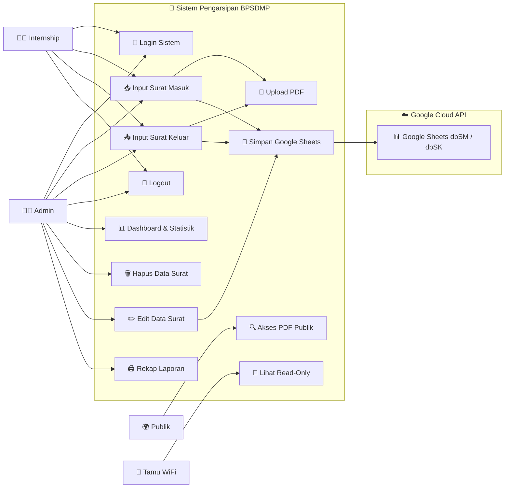
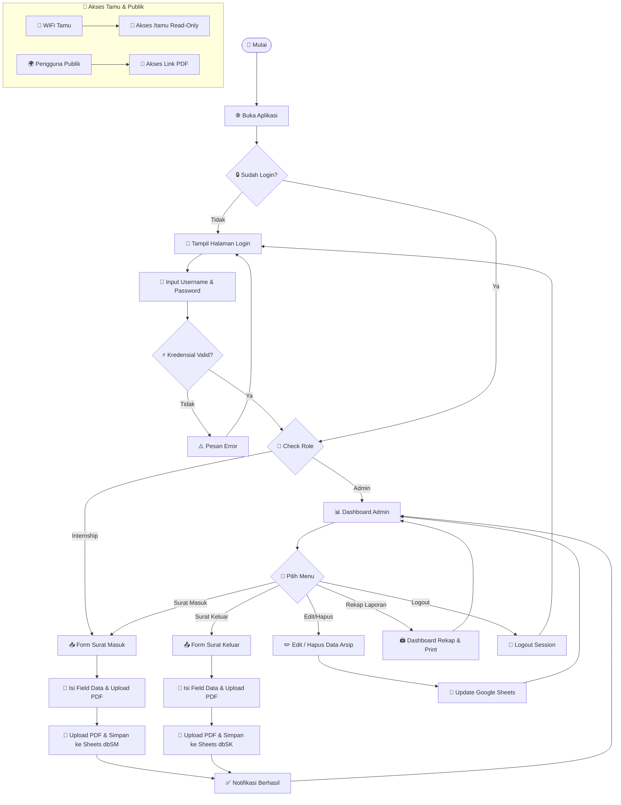
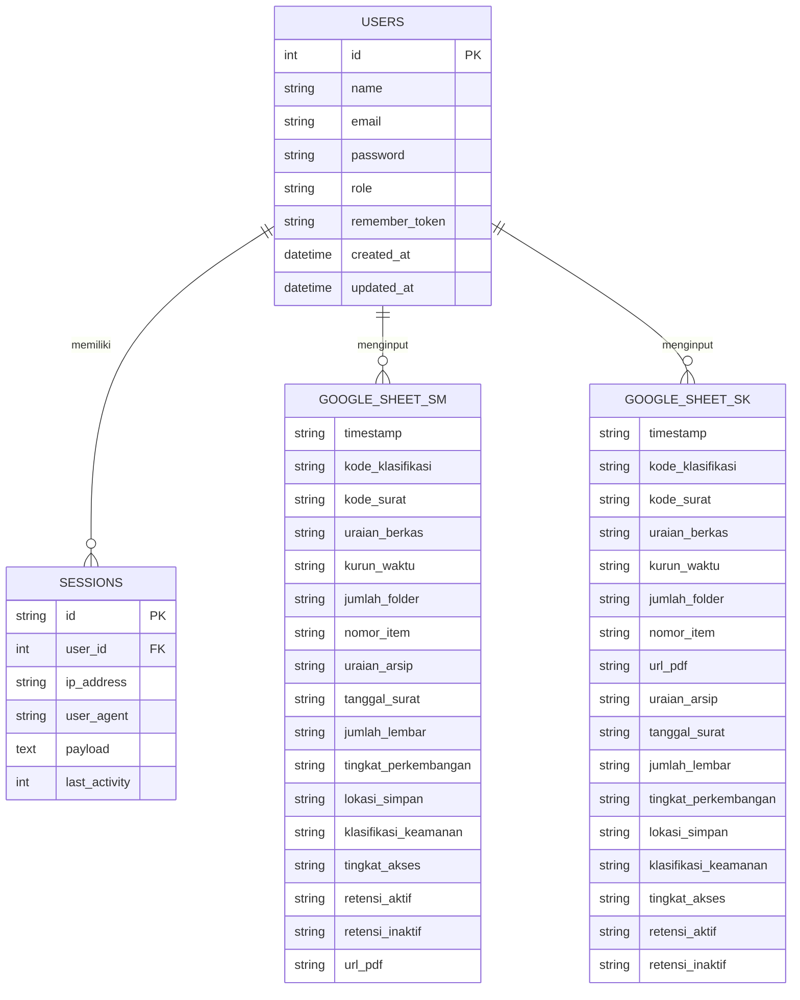

# 📂 Sistem Pengarsipan Digital Surat — BPSDMP

Aplikasi web berbasis **Laravel 13** untuk pengarsipan surat masuk dan surat keluar secara digital. Data arsip disimpan langsung ke **Google Spreadsheet** via Google Sheets API, file PDF disimpan di server lokal dan Google Drive.

---

## ⚡ Quick Start — Jalankan Pertama Kali (Mode 1-Pintu)

Setelah melakukan `git clone` pada PC server khusus, Anda **cukup menjalankan 1 berkas skrip master** tanpa perlu konfigurasi manual:

1. Buka folder proyek dan klik ganda berkas:
   ```cmd
   setup-and-run.bat
   ```
   *(atau jalankan `start-all.bat`)*

2. Skrip master 1-Pintu akan secara otomatis mengeksekusi alur berikut:
   - 🔑 **UAC Elevation**: Meminta akses Administrator Windows otomatis
   - ⚡ **Service Laragon**: Menyalakan Apache & MySQL
   - 📝 **Environment**: Mengisi berkas `.env` & generate `APP_KEY`
   - 🗄️ **Database**: Membuat database `arsip_bpsdmp`, menjalankan migrasi & seed
   - 🌐 **Virtual Host**: Membuat VirtualHost Apache `kearsipan.local.conf`
   - 📌 **Hosts File**: Mendaftarkan domain `127.0.0.1 kearsipan.local` di `hosts` Windows
   - 🛡️ **Firewall**: Membuka Inbound Port 80 pada Windows Firewall
   - 🧹 **Storage & Cache**: Membersihkan temporary views, sessions, & cache/data (`storage:clean`)

3. Akses aplikasi melalui browser:
   - **Akses Staff / Admin**: `http://kearsipan.local/`
   - **Akses WiFi Tamu (Read-Only)**: `http://kearsipan.local/tamu`

---

## 🚀 Fitur Utama

- 🔐 **Autentikasi & RBAC** — Akses login aman dengan multi-role (Admin & Internship).
- 📥 **Arsip Surat Masuk & Keluar** — Input data lengkap dan upload file PDF.
- ✏️ **Edit & Hapus Data** — Pengelolaan data arsip langsung terintegrasi dengan Google Sheets.
- 🔍 **Filter & Klasifikasi** — Filter pencarian berdasarkan kode klasifikasi surat.
- 📊 **Dashboard & Rekapitulasi** — Statistik data arsip bulanan, tahunan, dan per klasifikasi.
- 🌐 **Intranet Ready** — Dapat diakses di jaringan lokal (LAN/WiFi) menggunakan domain `kearsipan.local`.
- 🔒 **Cybersecurity Layer** — Proteksi terhadap Formula Injection, CSP, Rate Limiting, dan Session Protection.

---

## 🛠️ Tech Stack

- **Framework**: Laravel 13 (PHP 8.3+)
- **Database**: MySQL / MariaDB (untuk autentikasi & session)
- **Integrasi**: Google Sheets API v4 & Google Drive API
- **Frontend**: Blade + Vanilla CSS (Aesthetically Rich & Dark Mode)
- **Web Server**: Apache (Laragon) — Virtual Host `kearsipan.local`

---

## 👤 Use Case Diagram



---

## 🔄 Flowchart Sistem



---

## 📐 Entity Relationship Diagram (ERD)



---

## 🔒 Pemeliharaan & Jadwal Otomatis (Scheduler)

Aplikasi telah dilengkapi dengan **Laravel Task Scheduler** yang secara otomatis berjalan setiap pukul **00:00 (Tengah Malam)** untuk membersihkan berkas-berkas temporary pada direktori storage:
* `storage/framework/views` (Compiled Blade Views)
* `storage/framework/sessions` (File Session Usang)
* `storage/framework/cache/data` (Subfolder Cache Data)

Pembersihan manual juga dapat dilakukan kapan saja melalui terminal:
```bash
php artisan storage:clean
```
