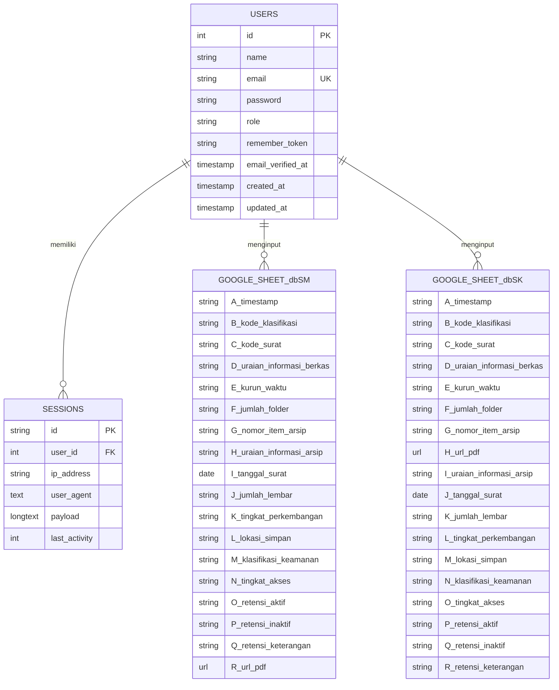
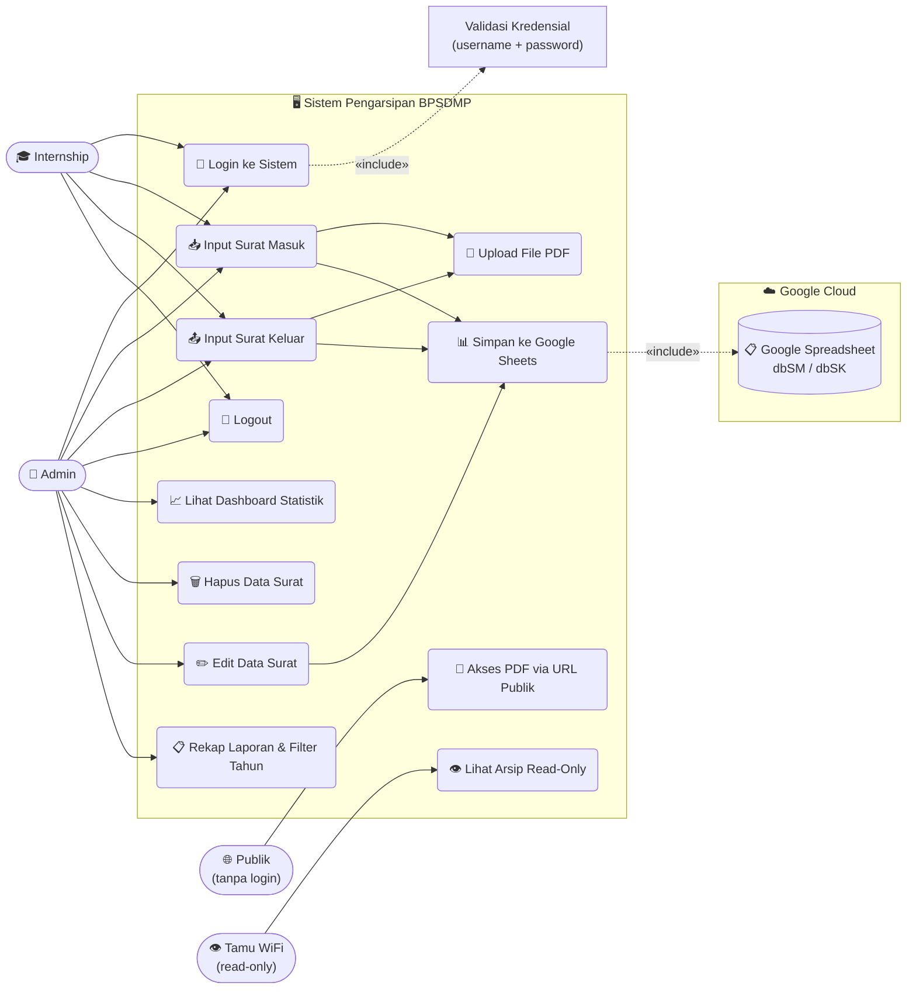

# 📂 Sistem Pengarsipan Digital Surat — BPSDMP

Aplikasi web berbasis **Laravel 13.19** untuk pengarsipan surat masuk dan surat keluar secara digital. Data arsip disimpan langsung ke **Google Spreadsheet** via Google Sheets API, file PDF disimpan di server lokal dan dapat **diakses publik** melalui URL unik tanpa perlu login.

---

## 🚀 Fitur Utama

- 🔐 **Autentikasi** — Login berbasis username & password dengan **2 role pengguna** (Admin & Internship)
- 🛡️ **Role-Based Access Control (RBAC)** — Admin punya akses penuh; Internship hanya bisa input form
- 📥 **Arsip Surat Masuk** — Input 17 field data + upload file PDF (maks. 10MB)
- 📤 **Arsip Surat Keluar** — Input 18 field data + upload file PDF (maks. 10MB)
- ✏️ **Edit Data** — Admin dapat mengedit semua field surat masuk & keluar via modal popup (update langsung ke Google Sheets dbSM/dbSK)
- 🗑️ **Hapus Data** — Hanya Admin yang dapat menghapus baris data dari Google Sheets
- 🔍 **Filter Kode Klasifikasi** — Dropdown filter kode (PR, KP, OT, dll) di tabel admin surat masuk & keluar
- 📊 **Google Sheets Integration** — Data tersimpan ke `dbSM`/`dbSK`; pembacaan data langsung dari sheet sumber (bukan sheet formula)
- 📎 **PDF Publik** — File PDF surat dapat diakses publik via URL `/pdf/{type}/{filename}` tanpa login
- 📈 **Dashboard Rangkuman** — Statistik bulanan & tahunan + pie chart klasifikasi; header tabel seragam navy (hanya Admin)
- 📋 **Rekap & Laporan** — Filter tahun (5 tahun terakhir) di Rekap Bulanan, Tahunan, Per Klasifikasi + tombol Cetak per Tab
- 🖼️ **Logo Komdigi** — Logo resmi Komdigi ditampilkan di header aplikasi
- 📱 **Responsive** — Hamburger/drawer menu untuk tampilan mobile & tablet
- 🌐 **Intranet Ready** — Dapat diakses oleh semua perangkat di jaringan WiFi yang sama tanpa internet
- 🔒 **Cybersecurity** — Formula Injection Protection, CSP, HSTS, XSS Protection, Rate Limiting, Session Security, IP-based Access Control

---

## 🛠️ Tech Stack

| Layer | Teknologi |
|---|---|
| Framework | Laravel 13.19 (PHP 8.3+) |
| Database | MySQL / MariaDB (auth & sessions) |
| Storage | Google Sheets API v4 |
| Frontend | Blade + Vanilla CSS (Pure CSS, tanpa framework) |
| Auth | Laravel Session Auth (`Auth::attempt`) |
| RBAC | Custom Middleware `AdminOnly` |
| File Upload | Local storage + Google Drive (backup) |
| Calendar | Flatpickr (CDN jsdelivr.net) |
| Web Server | Apache (Laragon) — port 80, virtual host `project-magang.test` |
| Tunnel | Ngrok (opsional, untuk akses publik via PC lokal) |

---

## 👤 Akun Pengguna

| Username | Role | Akses |
|---|---|---|
| `Admin` | `admin` | Dashboard, lihat tabel, hapus data, input form |
| `internship` | `internship` | Input form surat masuk & keluar saja |

> Password disimpan menggunakan **bcrypt** (`Hash::make()`). Untuk mengubah password, edit `database/seeders/DatabaseSeeder.php` lalu jalankan `php artisan db:seed --force`.

---

## 🔒 Role & Hak Akses

| Fitur / Halaman | Admin | Internship |
|---|:---:|:---:|
| Login / Logout | ✅ | ✅ |
| Form Input Surat Masuk | ✅ | ✅ |
| Form Input Surat Keluar | ✅ | ✅ |
| Lihat Tabel Daftar Surat | ✅ | ❌ |
| Edit Data Surat (Masuk/Keluar) | ✅ | ❌ |
| Hapus Surat (Masuk/Keluar) | ✅ | ❌ |
| Filter Kode Klasifikasi | ✅ | ❌ |
| Dashboard Statistik | ✅ | ❌ |
| Rekap Laporan + Filter Tahun | ✅ | ❌ |
| Akses PDF Publik | ✅ | ✅ (publik) |
| Akses Mode Tamu (WiFi Tamu) | ✅ | ✅ (read-only) |

> Pembatasan akses Admin dilakukan oleh middleware `App\Http\Middleware\AdminOnly`. Pengguna Internship yang mencoba mengakses route admin akan dialihkan ke halaman form.

---

## 🌐 Akses Intranet (WiFi Lokal)

### ⚠️ PENTING: Apakah Aplikasi Tetap Aktif Jika Laptop/Laragon Dimatikan?

**Jawaban singkat: ❌ TIDAK.** Aplikasi ini berjalan di laptop Anda sendiri sebagai server. Jika laptop atau Laragon dimatikan, **semua pengguna di WiFi lokal akan kehilangan akses.**

**Mengapa?**
- Laragon menjalankan **Apache Web Server** di laptop Anda (port 80/443)
- PHP memproses request di laptop Anda
- MySQL database tersimpan di laptop Anda
- Ketika laptop mati → tidak ada yang merespons request → semua koneksi timeout

**Cara agar selalu aktif:**
1. **Laptop harus selalu menyala** dan Laragon harus running (`Start All`)
2. Opsi terbaik: gunakan **PC/server dedicated** yang tidak pernah dimatikan
3. Opsi kedua: aktifkan **Windows Hibernate** agar laptop bisa "sleep" tanpa shutdown total

### Apa yang Dilakukan `start-intranet.bat`?

Script ini menjalankan **3 langkah otomatis** setiap kali dieksekusi:

| Langkah | Apa yang Terjadi |
|---|---|
| 1. Deteksi IP | Mendeteksi IP WiFi aktif laptop server via PowerShell (mengabaikan hotspot `192.168.137.x`) |
| 2. Update `.env` | Mengubah `APP_URL` dan `INTERNAL_NETWORK_SUBNET` di `.env` sesuai IP yang terdeteksi |
| 3. Jalankan Server | Pilihan: Laragon (Apache) **atau** `php artisan serve --host=0.0.0.0 --port=8000` |

IP yang terdeteksi digunakan oleh **2 middleware keamanan**:
- **`InternalNetworkOnly`** — Melindungi route write/delete (input surat, hapus data, dashboard). Hanya IP dari `INTERNAL_NETWORK_SUBNET` yang diizinkan.
- **`GuestNetwork`** — Mengizinkan akses read-only di `/tamu` dari subnet internal dan subnet tamu.

### Setup Akses Intranet

1. **Double-click** `start-intranet.bat` — script otomatis mendeteksi IP WiFi dan mengupdate `.env`
2. Pilih mode server:
   - **Mode 1 (Laragon/Apache)**: Akses via `http://{IP_SERVER}/` — **direkomendasikan untuk kantor**
   - **Mode 2 (Artisan Serve)**: Akses via `http://{IP_SERVER}:8000/` — untuk development/testing
3. Semua perangkat di jaringan WiFi/LAN yang sama bisa mengakses via IP server

### Perbandingan Mode Server

| Aspek | Mode 1 — Laragon (Apache) | Mode 2 — Artisan Serve |
|---|---|---|
| URL Akses | `http://IP` (port 80, tanpa port) | `http://IP:8000` |
| Auto-start | ✅ Bisa via Laragon Preferences | ❌ Harus run manual / bat Startup |
| Stabilitas | ✅ Production-grade, background | ⚠️ CMD harus tetap terbuka |
| Performa | ✅ Lebih baik untuk banyak user | ⚠️ Single-threaded |
| Rekomendasi | ✅ **Untuk deployment kantor** | Untuk development saja |

### 🏢 Panduan Deployment di Kantor BPSDMP

#### Apakah `start-intranet.bat` Harus Dijalankan Setiap Hari?

**Tergantung skenario:**

**Skenario A — IP Statis (⭐ PALING DISARANKAN)**
> Minta IT kantor set **IP statis** untuk PC/laptop server (contoh: `192.168.252.100`).
> Dengan IP yang tidak berubah:
> 1. Jalankan `start-intranet.bat` **SEKALI** saat pertama kali setup
> 2. Set Laragon **auto-start** saat Windows boot (Preferences → "Run Laragon when Windows starts")
> 3. **Selesai** — tidak perlu menjalankan bat lagi setiap hari
> 4. Laragon otomatis menyala setiap PC dinyalakan

**Skenario B — IP Dinamis (DHCP)**
> Jika IP berubah setiap kali connect WiFi/LAN:
> 1. `start-intranet.bat` **harus dijalankan setiap kali PC dinyalakan** agar IP di `.env` terupdate
> 2. Untuk otomatisasi, buat shortcut `start-intranet.bat` di folder Windows Startup:
>    ```
>    C:\Users\<NamaUser>\AppData\Roaming\Microsoft\Windows\Start Menu\Programs\Startup
>    ```
> 3. ⚠️ Jika memilih Mode 2 (Artisan), jendela CMD **harus tetap terbuka** selama jam kerja

#### Checklist Deployment Kantor

```
✅ Persiapan (sekali saja):
   □ Install Laragon di PC server
   □ Clone/copy project ke C:\laragon\www\project-magang\
   □ Jalankan: composer install
   □ Jalankan: php artisan migrate --seed
   □ Jalankan: php artisan storage:link
   □ Taruh file google-credentials.json di storage/app/
   □ Minta IT set IP statis untuk PC server (DISARANKAN)
   □ Pastikan Windows Firewall mengizinkan port 80 (Apache) atau 8000 (Artisan)

✅ Konfigurasi Auto-Start (sekali saja):
   □ Jalankan start-intranet.bat (pilih Mode 1 - Laragon)
   □ Buka Laragon → Preferences → centang "Run Laragon when Windows starts"
   □ (Opsional, jika DHCP) Taruh shortcut start-intranet.bat di Startup folder

✅ Operasional Harian:
   □ Nyalakan PC server → Laragon otomatis start (jika sudah di-set)
   □ Jika IP statis: tidak perlu lakukan apa-apa lagi
   □ Jika IP DHCP: pastikan start-intranet.bat sudah jalan (cek dari Startup)
   □ Jangan matikan PC server selama jam kerja
```

#### ⚠️ Hal Penting yang Harus Diperhatikan

1. **Windows Firewall** — Port 80 (Laragon) atau 8000 (Artisan) harus diizinkan di Firewall. Jika belum, PC lain di LAN tidak bisa mengakses meski server sudah jalan.
2. **Satu Jaringan WiFi/LAN** — Semua perangkat (server + client) harus terhubung ke jaringan yang sama. Subnet `/22` mencakup IP range `192.168.252.0` – `192.168.255.255`.
3. **PC Server Jangan Dimatikan** — Selama jam kerja, PC server harus tetap menyala. Jika mati, semua akses terputus.
4. **IP Berubah?** — Jika IP server berubah (DHCP), cukup jalankan ulang `start-intranet.bat` dan IP otomatis terupdate.
5. **Localhost Selalu Diizinkan** — Akses dari PC server sendiri (`127.0.0.1`) selalu diizinkan oleh kedua middleware.

### URL Intranet

| Pengguna | URL | Catatan |
|---|---|---|
| Staff/Admin | `http://{IP_SERVER}/` | Butuh login |
| Staff Surat Keluar | `http://{IP_SERVER}/surat-keluar` | Butuh login |
| Tamu (Read-only) | `http://{IP_SERVER}/tamu` | Tanpa login, read-only |
| Tamu Surat Keluar | `http://{IP_SERVER}/tamu/surat-keluar` | Tanpa login, read-only |
| Dashboard Admin | `http://{IP_SERVER}/dashboard` | Butuh login admin |

> Ganti `{IP_SERVER}` dengan IP aktual PC/laptop server (contoh: `192.168.252.85`). Jika menggunakan Mode 2 (Artisan), tambahkan `:8000` di belakang IP.

---

## 🌐 Akses PDF Publik

File PDF yang diupload dapat diakses **tanpa login** melalui URL:

```
https://domain-kamu.com/pdf/surat-masuk/{nama-file.pdf}
https://domain-kamu.com/pdf/surat-keluar/{nama-file.pdf}
```

- URL ini tersimpan otomatis di kolom **R (Surat Masuk)** dan **H (Surat Keluar)** di Google Sheets
- Dapat langsung diklik dari spreadsheet untuk membuka/mengunduh PDF
- Keamanan: hanya ekstensi `.pdf` yang diizinkan, path traversal dicegah

---

## 🔐 Cybersecurity — Lapisan Keamanan

Project ini mengimplementasikan **8 lapisan keamanan**:

### 1. HTTP Security Headers (`SecurityHeaders.php`)
```
Content-Security-Policy   → Batasi asal script/style (whitelist: self, CDN flatpickr, Google Fonts)
X-Frame-Options           → SAMEORIGIN (cegah Clickjacking)
X-Content-Type-Options    → nosniff (cegah MIME sniffing)
X-XSS-Protection          → 1; mode=block (browser lama)
Referrer-Policy           → strict-origin-when-cross-origin
Permissions-Policy        → Matikan camera/mic/geolocation
Strict-Transport-Security → 1 tahun (aktif saat HTTPS)
```

### 2. Rate Limiting — Anti Brute Force
- Login dibatasi **maks 5 percobaan per menit per IP+username**
- Jika melewati batas → blokir 60 detik
- Semua percobaan gagal dicatat di `storage/logs/laravel.log`

### 3. IP-Based Network Access Control
| Middleware | Fungsi |
|---|---|
| `InternalNetworkOnly` | Blokir request write/delete dari luar jaringan internal |
| `GuestNetwork` | Izinkan akses `/tamu` hanya dari WiFi tamu/internal |

> Subnet diatur via `config/network.php` yang membaca dari `.env`

### 4. Session Security
- Enkripsi session aktif (`SESSION_ENCRYPT=true`)
- Session cookie otomatis hancur saat browser ditutup (`SESSION_EXPIRE_ON_CLOSE=true`)
- Session di-regenerate saat login (`session()->regenerate()`)
- Session di-invalidate saat logout (`invalidate()` + `regenerateToken()`)

### 5. CSRF Protection
- Semua form POST/DELETE menggunakan `@csrf` token
- Token divalidasi otomatis oleh Laravel

### 6. Input Validation & Sanitization
- Semua input divalidasi di controller sebelum diproses
- Path traversal dicegah via regex di route PDF/Image
- Kode Klasifikasi: hanya 2 karakter huruf, paksa uppercase (JS)

### 7. Formula Injection Protection (Google Sheets)
- Semua data string yang dikirim ke Google Sheets disanitasi via `escapeFormula()`
- Input yang diawali `=`, `+`, `-`, `@` diescaping dengan prefix `'` untuk mencegah eksekusi formula berbahaya di spreadsheet

### 8. Audit Logging
- Login berhasil/gagal: dicatat ke `storage/logs/laravel.log`
- Log level: `warning` untuk production (tidak expose debug info)

---

## ⚡ Cara Menjalankan Lokal (Laragon)

> Tidak perlu `php artisan serve` — langsung menggunakan Apache Laragon.

### Prasyarat
- Laragon terinstall & Apache **berjalan** (`Start All`)
- PHP 8.3+ dengan extension `pdo_mysql` aktif di `php.ini`
- MySQL / MariaDB aktif di Laragon
- Virtual host `project-magang.test` terkonfigurasi
- Kredensial Google Service Account tersimpan di `storage/app/google-credentials.json`

### Langkah Setup Awal (sekali saja)
```bash
# 1. Clone project
cd C:\laragon\www
# (letakkan folder project-magang di sini)

# 2. Install dependencies
composer install

# 3. Buat file .env
cp .env.example .env
php artisan key:generate

# 4. Migrasi & seed database (buat tabel + akun admin & internship)
php artisan migrate --seed

# 5. Buat symlink storage
php artisan storage:link
```

### Menjalankan Sehari-hari
1. Pastikan **Laragon** aktif (Apache & MySQL menyala)
2. Akses lokal: `http://project-magang.test`
3. Untuk akses intranet WiFi, **double-click** `start-intranet.bat`
4. Untuk akses publik via ngrok, **double-click** `start-ngrok.bat`

---

## 📐 Entity Relationship Diagram (ERD)

> Tabel `users` digunakan hanya untuk autentikasi. Data arsip surat disimpan di Google Sheets, bukan di database lokal.



---

## 🔄 Flowchart Sistem

```mermaid
flowchart TD
    A([Mulai]) --> B[Buka Aplikasi]
    B --> C{Sudah Login?}
    C -- Tidak --> D[Tampil Halaman Login]
    D --> E[Masukkan Username & Password]
    E --> F{Kredensial Valid?}
    F -- Tidak --> G[Tampil Pesan Error\nKembali ke Login]
    G --> D
    F -- Ya --> ROLE{Role Pengguna?}
    ROLE -- Admin --> H[Masuk Dashboard Utama]
    ROLE -- Internship --> J[Buka Form Surat Masuk]
    C -- Ya --> ROLE

    H --> I{Pilih Menu}

    I -- Surat Masuk --> J[Buka Form Surat Masuk]
    J --> K[Isi 17 Field Data]
    K --> L[Upload File PDF]
    L --> M{Validasi Form}
    M -- Gagal --> N[Tampil Pesan Error\nForm tetap terisi]
    N --> K
    M -- Lolos --> O[Upload PDF ke Google Drive\nBackup lokal ke uploads/]
    O --> P[Kirim Data ke Google Sheets\nSheet: dbSM kolom A–R]
    P --> Q[Tampil Notifikasi Berhasil]
    Q --> H

    I -- Surat Keluar --> R[Buka Form Surat Keluar]
    R --> S[Isi 18 Field Data]
    S --> T[Upload File PDF]
    T --> U{Validasi Form}
    U -- Gagal --> V[Tampil Pesan Error\nForm tetap terisi]
    V --> S
    U -- Lolos --> W[Upload PDF ke Google Drive\nBackup lokal ke uploads/]
    W --> X[Kirim Data ke Google Sheets\nSheet: dbSK kolom A–R]
    X --> Y[Tampil Notifikasi Berhasil]
    Y --> H

    I -- Dashboard --> DA[Tampil Statistik Bulanan & Tahunan]
    DA --> DB[Pie Chart Kode Klasifikasi]
    DB --> H

    I -- Hapus Data --> DEL{Konfirmasi Hapus?}
    DEL -- Ya --> DELACT[Hapus baris dari Google Sheets dbSM/dbSK]
    DELACT --> H
    DEL -- Tidak --> H

    I -- Edit Data --> EDIT[Klik tombol Edit di tabel]
    EDIT --> EDITFETCH[AJAX fetch data baris\n/arsip/{index}/edit → JSON]
    EDITFETCH --> EDITMODAL[Modal Edit pre-filled\n17 field data surat]
    EDITMODAL --> EDITSUB{Submit form PUT?}
    EDITSUB -- Ya --> EDITUPDATE[Update baris di dbSM/dbSK\nspreadsheets.values.update]
    EDITUPDATE --> H
    EDITSUB -- Tidak/Batal --> H

    I -- Rekap --> RPT[Dashboard Report]
    RPT --> RPT2[Filter Tahun per Tab\nRekap Bulanan/Tahunan/Klasifikasi]
    RPT2 --> RPT3[Cetak Tab / Cetak Semua]
    RPT3 --> H

    I -- Keluar --> Z[Logout Session]
    Z --> D

    PUB([Pengguna Publik]) --> PURL[Akses URL PDF\n/pdf/type/filename]
    PURL --> PCHECK{File Ada?}
    PCHECK -- Ya --> PPDF[Tampil PDF di Browser]
    PCHECK -- Tidak --> P404[404 Not Found]

    TAMU([WiFi Tamu]) --> TAMUURL[Akses /tamu]
    TAMUURL --> TAMUCHECK{IP dari subnet tamu/internal?}
    TAMUCHECK -- Ya --> TAMUVIEW[Tampil Tabel Read-Only]
    TAMUCHECK -- Tidak --> T403[403 Forbidden]
```

---

## 👤 Use Case Diagram



---

## 🗂️ Struktur Direktori Penting

```
project-magang/
├── app/
│   └── Http/
│       ├── Controllers/
│       │   ├── ArsipController.php          ← Surat Masuk (index, store, edit, update, destroy)
│       │   ├── SuratKeluarController.php    ← Surat Keluar (index, store, edit, update, destroy)
│       │   ├── DashboardController.php      ← Statistik bulanan/tahunan dari Google Sheets
│       │   └── Auth/
│       │       └── LoginController.php      ← Login & Logout (session auth + rate limiting)
│       └── Middleware/
│           ├── AdminOnly.php                ← RBAC: blokir akses non-admin ke route admin
│           ├── InternalNetworkOnly.php      ← Blokir write/delete dari WiFi tamu
│           ├── GuestNetwork.php             ← Izinkan /tamu dari WiFi tamu/internal
│           └── SecurityHeaders.php          ← HTTP Security Headers (CSP, HSTS, dll.)
├── bootstrap/
│   └── app.php                              ← TrustProxies + register middleware alias
├── config/
│   ├── google.php                           ← Konfigurasi Google Sheets & Drive API
│   └── network.php                          ← Konfigurasi subnet intranet & tamu
├── database/
│   ├── migrations/                          ← Tabel users (+ kolom role), sessions
│   └── seeders/
│       └── DatabaseSeeder.php               ← Akun Admin & Internship (bcrypt)
├── public/
│   ├── css/
│   │   └── app.css                          ← Stylesheet utama (Vanilla CSS, dark mode)
│   └── storage/                             ← Symlink ke storage/app/public/
├── resources/
│   └── views/
│       ├── auth/
│       │   └── login.blade.php              ← Halaman login (dark glassmorphism)
│       ├── arsip/
│       │   ├── index.blade.php              ← Tabel + form surat masuk (RBAC-aware)
│       │   └── surat-keluar.blade.php       ← Tabel + form surat keluar (RBAC-aware)
│       ├── tamu/
│       │   ├── index.blade.php              ← Surat masuk read-only (WiFi tamu)
│       │   └── surat-keluar.blade.php       ← Surat keluar read-only (WiFi tamu)
│       ├── dashboard/
│       │   └── index.blade.php              ← Dashboard statistik & chart (admin only)
│       └── layouts/
│           └── app.blade.php                ← Layout utama (sidebar drawer + header)
├── routes/
│   └── web.php                              ← Route auth, publik PDF, protected, admin-only, tamu
├── storage/
│   ├── app/
│   │   ├── google-credentials.json          ← Service Account Google API (JANGAN di-commit)
│   │   └── public/                          ← File publik via symlink
│   ├── image/
│   │   └── komdigi-logo.png                 ← Logo header aplikasi
│   └── uploads/                             ← Backup PDF lokal (temporary)
├── start-intranet.bat                       ← Script 1-klik: aktifkan server intranet WiFi
├── start-ngrok.bat                          ← Script 1-klik untuk jalankan ngrok
└── C:\laragon\etc\apache2\sites-enabled\
    └── auto.project-magang.test.conf        ← Virtual host Apache Laragon
```

---

## 📋 Kolom Google Sheets

> Sheet `dbSM` dan `dbSK` adalah **sumber data tulis** (tempat form menyimpan data). Aplikasi membaca langsung dari sheet sumber ini tanpa bergantung pada formula sheet tampilan.

### Sheet `dbSM` — Sumber Data Surat Masuk (Kolom A–R)

| Kolom | Field |
|---|---|
| A | Timestamp |
| B | Kode Klasifikasi |
| C | Kode Surat |
| D | Uraian Informasi Berkas |
| E | Kurun Waktu |
| F | Jumlah Folder |
| G | Nomor Item Arsip |
| H | Uraian Informasi Arsip |
| I | Tanggal Surat |
| J | Jumlah Lembar |
| K | Tingkat Perkembangan |
| L | Lokasi Simpan |
| M | Klasifikasi Keamanan |
| N | Tingkat Akses |
| O | Retensi Aktif |
| P | Retensi Inaktif |
| Q | Retensi Keterangan |
| R | **Filename PDF** *(digunakan untuk generate URL publik secara dinamis)* |

### Sheet `dbSK` — Sumber Data Surat Keluar (Kolom A–R)

| Kolom | Field |
|---|---|
| A | Timestamp |
| B | Kode Klasifikasi |
| C | Kode Surat |
| D | Uraian Informasi Berkas |
| E | Kurun Waktu |
| F | Jumlah Folder |
| G | Nomor Item Arsip |
| H | **Filename PDF** |
| I | Uraian Informasi Arsip |
| J | Tanggal Surat |
| K | Jumlah Lembar |
| L | Tingkat Perkembangan |
| M | Lokasi Simpan |
| N | Klasifikasi Keamanan |
| O | Tingkat Akses |
| P | Retensi Aktif |
| Q | Retensi Inaktif |
| R | Retensi Keterangan |

---

## 🔄 Changelog Signifikan

| Versi | Perubahan |
|---|---|
| v1.0 | Setup awal: form surat masuk + keluar + Google Sheets |
| v1.1 | Sistem autentikasi login/logout (database-backed) |
| v1.2 | Responsive layout: hamburger/drawer menu mobile & tablet |
| v1.3 | Dashboard statistik bulanan & tahunan + pie chart |
| v1.4 | Apache Laragon virtual host (`project-magang.test`) — tanpa `artisan serve` |
| v1.5 | **PDF Publik**: Route `/pdf/{type}/{filename}` tanpa autentikasi |
| v1.5 | URL PDF (filename saja) tersimpan ke Google Sheets (bisa diklik dari spreadsheet) |
| v1.6 | **RBAC**: Role `admin` & `internship`, middleware `AdminOnly` |
| v1.6 | Internship hanya bisa input form; Admin punya akses penuh termasuk hapus data |
| v1.6 | Tampilan tabel & dashboard disembunyikan dari user Internship |
| v1.7 | Upgrade framework ke **Laravel 13** / PHP 8.3+ |
| v1.7 | Navigasi drawer: icon burger konsisten di semua ukuran layar |
| v1.8 | **Logo Komdigi**: header aplikasi menggunakan `komdigi-logo.png` |
| v1.9 | **Anti-FOUC**: CSS tabel dipindah ke `@push('styles')` → dirender di `<head>` |
| v1.9 | **Skeleton Loading**: shimmer placeholder tabel sebelum data ditampilkan |
| v1.9 | **Page Loading Bar**: indikator progress tipis di atas halaman saat navigasi |
| v2.0 | **Intranet Mode**: `start-intranet.bat` — deteksi IP otomatis, update `.env`, 2 mode server |
| v2.0 | **Cybersecurity Layer**: `SecurityHeaders`, `InternalNetworkOnly`, `GuestNetwork` middleware |
| v2.0 | **Mode Tamu WiFi**: route `/tamu` & `/tamu/surat-keluar` — read-only tanpa login |
| v2.0 | **Rate Limiting** login: 5 percobaan/menit per IP+username (brute force protection) |
| v2.0 | **Session Security**: enkripsi session + expire on close + regenerate on login |
| v2.1 | **Filter Kode Klasifikasi**: Dropdown filter kode di tabel SM & SK admin |
| v2.1 | **Edit Data**: Tombol Edit via Modal popup pre-filled (AJAX → PUT ke Google Sheets) |
| v2.1 | **Filter Tahun Rekap**: Dropdown 5 tahun terakhir di Rekap Bulanan, Tahunan, Per Klasifikasi |
| v2.1 | **Cetak Per Tab**: Tombol cetak hanya tab yang aktif di halaman rekap |
| v2.2 | **Migrasi Database**: SQLite → MySQL/MariaDB (kompatibel phpMyAdmin) |
| v2.2 | **Formula Injection Protection**: Sanitasi input `=`, `+`, `-`, `@` sebelum simpan ke Sheets |
| v2.2 | **Baca Langsung dari dbSM/dbSK**: Tidak lagi bergantung pada sheet formula (ARRAYFORMULA) |
| v2.2 | **config/network.php** & **config/google.php**: Tidak ada `env()` di runtime code (aman untuk `config:cache`) |
| v2.2 | **Cleanup Otomatis**: File PDF lokal (`uploads/`) terhapus setelah hapus data dari Sheets |

---

## 📜 Lisensi

Proyek ini dikembangkan untuk keperluan magang di **BPSDMP** (Balai Pengembangan Sumber Daya Manusia dan Penelitian). Tidak untuk didistribusikan secara publik.
