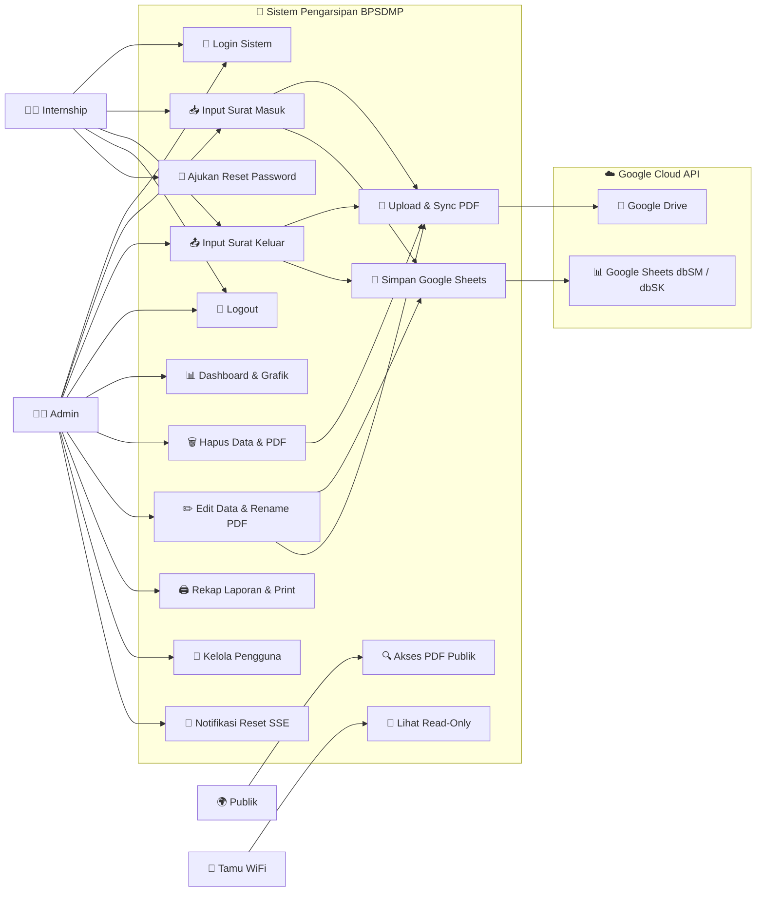
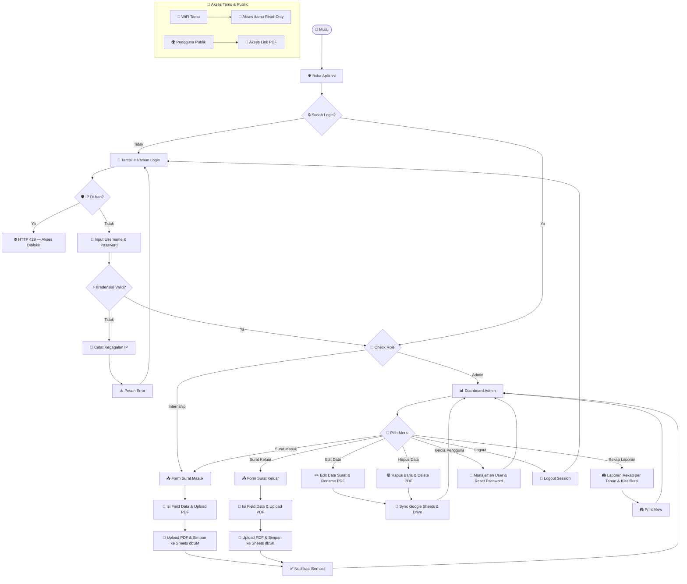
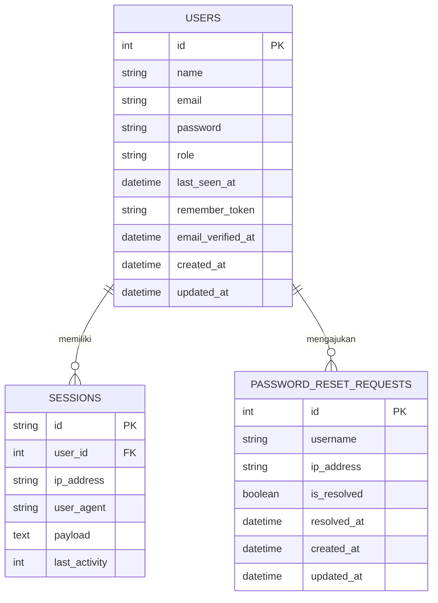

# 📂 Sistem Pengarsipan Digital Surat — BPSDMP

Aplikasi web berbasis **Laravel 13** untuk pengarsipan surat masuk dan surat keluar secara digital. Data arsip disimpan secara aman ke **Google Spreadsheet** via Google Sheets API v4, dan file PDF fisik dikelola secara sinkron di server lokal (`/uploads`) serta **Google Drive API**.

---

## ⚡ Quick Start — Setup Awal & Jalankan Aplikasi

Setelah melakukan `git clone` pada PC server khusus, Anda dapat mengelola jalannya aplikasi menggunakan skrip otomatisasi berikut:

### 📥 1. Inisialisasi Pertama Kali (Setup)
Jalankan file berikut **hanya pada saat instalasi pertama kali** di server:
```cmd
setup-and-run.bat
```
Skrip ini memerlukan hak akses **Administrator** untuk melakukan konfigurasi otomatis:
- 🔑 **UAC Elevation** — Meminta akses Administrator Windows otomatis.
- ⚡ **Service Laragon** — Menyalakan dan mengaktifkan Apache & MySQL di Laragon.
- 📝 **Environment** — Membuat berkas `.env` jika belum ada & mengisi parameter default.
- 🗄️ **Database** — Membuat database `arsip_bpsdmp`, menjalankan migrasi, dan seeder user default.
- 🌐 **Virtual Host** — Membuat VirtualHost Apache `kearsipan.local.conf` di Laragon.
- 📌 **Hosts File** — Mendaftarkan domain `127.0.0.1 kearsipan.local` di berkas `hosts` Windows.
- 🛡️ **Firewall** — Membuka Inbound Port 80 pada Windows Firewall.
- 🧹 **Storage & Cache** — Melakukan pembersihan berkas temporary views & cache framework data.

### 🚀 2. Menjalankan Aplikasi Sehari-hari (Daily Runner)
Untuk penggunaan sehari-hari setelah setup awal berhasil, gunakan skrip runner ringan:
```cmd
autostart.bat
```
Atau gunakan skrip server lengkap dengan komponen Queue & Scheduler:
```cmd
"Arsip Surat (server).bat"
```
Skrip ini akan menjalankan:
- ⚡ **Service Check** — Memastikan Laragon, Apache, dan MySQL sudah aktif.
- ⚙️ **Queue Worker** — Menyalakan Laravel Queue Worker di latar belakang.
- 🕔 **Task Scheduler** — Menyalakan `php artisan schedule:work` di latar belakang (otomatis menjalankan pembersihan storage setiap pukul **17:00** dan prune sesi setiap jam).
- 🌐 **Auto-Launch** — Membuka browser langsung ke URL login aplikasi.

### 🌐 3. Akses Aplikasi
- **Akses Komputer Server (Lokal)**: `http://kearsipan.local/`
- **Akses Perangkat Lain (HP/Laptop via LAN/Wi-Fi)**:
  - HTTP: `http://<IP-SERVER>/` (sesuaikan dengan IP server lokal)
  - HTTPS: `https://<IP-SERVER>/`
  *(Catatan: Akses via subfolder seperti `http://<IP-SERVER>/project-magangv1` otomatis di-redirect ke root aplikasi tanpa 404).*
- **Akses WiFi Tamu (Read-Only Tanpa Login)**:
  - `http://kearsipan.local/tamu`
  - `http://<IP-SERVER>/tamu`

---

## 🚀 Fitur Utama

| Fitur | Deskripsi |
|---|---|
| 🔐 **Autentikasi & RBAC** | Login aman dengan multi-role: `admin` & `internship`. Login bisa pakai `name` atau `email`. |
| 📥 **Surat Masuk** | Input data lengkap + upload PDF, tersimpan ke Google Sheets (`dbSM`) dengan 18 kolom |
| 📤 **Surat Keluar** | Input data lengkap + upload PDF, tersimpan ke Google Sheets (`dbSK`) dengan 18 kolom |
| ✏️ **Edit & Rename PDF** | Edit data surat otomatis mengubah nama file PDF di lokal (`/uploads`) & Google Drive |
| 🗑️ **Hapus Synchronous** | Hapus data surat otomatis menghapus file PDF dari lokal (`/uploads`) & Google Drive |
| 🔍 **Filter & Klasifikasi** | Pencarian & filter berdasarkan bulan, tahun, dan kode klasifikasi surat |
| 📊 **Dashboard & Grafik Bar** | Statistik data arsip bulanan, tahunan, & angka total di atas batang grafik (Chart.js + datalabels) |
| 🖨️ **Laporan Rekap Printable** | Tampilan rekap laporan lengkap per tahun, per klasifikasi, detail bulanan SM & SK |
| 🖨️ **Print Dashboard** | Tampilan cetak profesional dengan kisi garis seragam (`1pt solid #333`) |
| 👥 **Manajemen Pengguna** | Admin dapat mereset password internship & menindaklanjuti permintaan reset |
| 🔔 **Notifikasi Realtime (SSE)** | Admin mendapat notifikasi realtime saat internship mengajukan reset password, dengan fallback polling |
| ⚡ **Dual-Tier Cache Sheets** | Cache mikro Admin 30 detik, cache normal non-admin 60 detik. Invalidasi instan saat store/update/destroy |
| ⏱️ **Sesi 4 Jam & Auto-Prune** | Masa aktif sesi 240 menit di database MySQL dengan pembersihan expired per jam |
| 🌐 **Intranet Speed & Smooth Nav** | Loading animation kontekstual & font fallback sistem lokal untuk navigasi instan di Intranet |
| 👀 **Mode Tamu (Read-Only)** | Halaman khusus WiFi tamu tanpa login untuk membaca data arsip surat masuk & keluar |
| 🔒 **Cybersecurity Layer** | Brute Force IP Ban, Formula Injection Guard, CSP, Rate Limiting, Security Headers, Production Hardening |
| 🧹 **Task Scheduler** | Pembersihan otomatis sesi expired setiap 1 jam & berkas temporary storage setiap 17:00 |
| 🌐 **Multi-Subnet Support** | Dukungan beberapa subnet sekaligus dipisah koma di `.env` (IPv4 & IPv6 via `ChecksIpSubnet` trait) |
| 🔄 **Kode Klasifikasi Auto-fill** | Kolom retensi & keamanan terisi otomatis berdasarkan `KODE_MAP` sesuai jadwal retensi arsip |
| 🛡️ **Trusted Proxy Support** | Mendukung konfigurasi `TRUSTED_PROXIES` untuk deployment di balik reverse proxy/nginx |

---

## 🛠️ Tech Stack

| Lapisan | Teknologi |
|---|---|
| **Framework** | Laravel 13 (PHP 8.3+) |
| **Database** | MySQL / MariaDB (autentikasi, session, password reset requests) |
| **Penyimpanan Data** | Google Sheets API v4 (`dbSM` & `dbSK`) via Service Account |
| **Penyimpanan File** | Server Lokal (`/uploads`) + Google Drive API (dual backup) |
| **Frontend** | Blade Templates + Vanilla CSS (Dark Mode) + Chart.js (+ datalabels plugin) |
| **Web Server** | Apache via Laragon — Virtual Host `kearsipan.local` (port 80 & 443 SSL) |
| **Real-time** | Server-Sent Events (SSE) + polling fallback untuk notifikasi reset password |
| **Cache** | Laravel Cache (file driver, dapat diganti Redis/Memcached via `CACHE_STORE`) |
| **Dependency** | `google/apiclient:^2.0` (Sheets & Drive API services) |
| **Dev Tools** | Laravel Pail, Laravel Pao, Laravel Pint, PHPUnit 12, Faker |

---

## 👥 Peran & Hak Akses

| Kemampuan | Admin | Internship | Tamu (WiFi) | Publik |
|---|:---:|:---:|:---:|:---:|
| Login | ✅ | ✅ | ❌ | ❌ |
| Input Surat Masuk | ✅ | ✅* | ❌ | ❌ |
| Input Surat Keluar | ✅ | ✅* | ❌ | ❌ |
| Edit Data & Rename PDF | ✅ | ❌ | ❌ | ❌ |
| Hapus Data & Hapus PDF | ✅ | ❌ | ❌ | ❌ |
| Dashboard & Rekap | ✅ | ❌ | ❌ | ❌ |
| Print Laporan | ✅ | ❌ | ❌ | ❌ |
| Kelola Pengguna | ✅ | ❌ | ❌ | ❌ |
| Ajukan Reset Password | ❌ | ✅ | ❌ | ❌ |
| Lihat Arsip (Read-Only) | ✅ | ✅ | ✅ | ❌ |
| Akses PDF Publik | ✅ | ✅ | ✅ | ✅ |

> \* Input hanya bisa dilakukan dari **jaringan internal** (`INTRANET_ENABLED=true`). Jika `INTRANET_ENABLED=false`, semua IP diizinkan (mode development).

---

## 🗺️ Peta Rute (Routes)

### Publik (Tanpa Login)
| Method | URL | Keterangan |
|---|---|---|
| `GET` | `/login` | Halaman login |
| `POST` | `/login` | Proses login *(Rate Limiting: 5 percobaan / 5 menit per username+IP)* |
| `POST` | `/logout` | Proses logout |
| `POST` | `/password/request-reset` | Ajukan permintaan reset password *(throttle: 3 req / 5 menit)* |
| `GET` | `/pdf/{type}/{filename}` | Akses file PDF publik dari `/uploads/` |
| `GET` | `/image/{filename}` | Akses file gambar dari `storage/image/` |

### Terautentikasi (Admin & Internship)
| Method | URL | Keterangan |
|---|---|---|
| `GET` | `/` | Daftar Surat Masuk (`arsip.index`) |
| `POST` | `/arsip` | Simpan Surat Masuk baru *(internal_only)* |
| `GET` | `/surat-keluar` | Daftar Surat Keluar |
| `POST` | `/surat-keluar` | Simpan Surat Keluar baru *(internal_only)* |

### Admin Only *(auth + AdminOnly + internal_only)*
| Method | URL | Keterangan |
|---|---|---|
| `GET` | `/dashboard` | Dashboard statistik & grafik batang |
| `GET` | `/dashboard/report` | Rekap laporan lengkap per tahun & klasifikasi |
| `GET` | `/dashboard/print` | Tampilan cetak print-friendly laporan |
| `GET` | `/arsip/{rowIndex}/edit` | Form edit Surat Masuk (JSON response) |
| `PUT` | `/arsip/{rowIndex}` | Update Surat Masuk + Rename PDF |
| `DELETE` | `/arsip/{rowIndex}` | Hapus Surat Masuk + Hapus PDF |
| `GET` | `/surat-keluar/{rowIndex}/edit` | Form edit Surat Keluar (JSON response) |
| `PUT` | `/surat-keluar/{rowIndex}` | Update Surat Keluar + Rename PDF |
| `DELETE` | `/surat-keluar/{rowIndex}` | Hapus Surat Keluar + Hapus PDF |
| `GET` | `/admin/users` | Kelola pengguna & lihat permintaan reset |
| `POST` | `/admin/users/{user}/reset-password` | Reset password pengguna |
| `POST` | `/admin/password-reset-requests/{id}/resolve` | Tandai permintaan reset selesai |
| `GET` | `/sse/reset-requests` | Stream SSE notifikasi reset password realtime |
| `GET` | `/api/reset-requests-version` | Polling fallback versi permintaan reset |

### Tamu WiFi (Read-Only, Tanpa Login) *(guest_network)*
| Method | URL | Keterangan |
|---|---|---|
| `GET` | `/tamu` | Daftar Surat Masuk (read-only) |
| `GET` | `/tamu/surat-keluar` | Daftar Surat Keluar (read-only) |

---

## 👤 Use Case Diagram



---

## 🔄 Flowchart Sistem



---

## 📐 Entity Relationship Diagram (ERD)



> **Catatan Arsitektur**: Google Sheets (`dbSM` & `dbSK`) bukan tabel relasional — data arsip disimpan langsung di spreadsheet Google, bukan di MySQL. MySQL hanya digunakan untuk autentikasi, session, dan password reset requests.
>
> **Kolom dbSM** (18 kolom A–R): `timestamp`, `kode_klasifikasi`, `kode_surat`, `uraian_berkas`, `kurun_waktu`, `jumlah_folder`, `nomor_item_arsip`, `uraian_informasi_arsip`, `tanggal_surat`, `jumlah_lembar`, `tingkat_perkembangan`, `lokasi_simpan`, `klasifikasi_keamanan`, `tingkat_akses`, `retensi_aktif`, `retensi_inaktif`, `retensi_keterangan`, `url_pdf`
>
> **Kolom dbSK** (18 kolom A–R): sama seperti dbSM, tetapi kolom H adalah `url_pdf` (PDF di posisi berbeda) dan I–R menggeser urutan.

---

## 🔒 Keamanan (Security Layer)

Aplikasi dilengkapi dengan sistem perlindungan komprehensif berlapis:

| Komponen | Mekanisme & Fungsi |
|---|---|
| `BruteForceIpBan` | Memantau percobaan login gagal per IP. Jika gagal **20 kali dalam 10 menit**, IP diblokir otomatis selama **1 jam** (HTTP 429). Tercatat ke log. |
| **Rate Limiter** | Pembatasan login per username+IP: lockout **5 menit** setelah 5 percobaan gagal. Reset password: maks **3 req / 5 menit** (throttle middleware). |
| `AdminOnly` | Membatasi akses rute administratif hanya untuk akun role `admin`. |
| `InternalNetworkOnly` | Membatasi akses input/edit/hapus hanya dari subnet jaringan internal kantor (multi-subnet CIDR). |
| `GuestNetwork` | Membatasi rute `/tamu` agar hanya dapat diakses dari subnet tamu atau jaringan internal. |
| `SecurityHeaders` | Menambahkan HTTP security headers: CSP, `X-Robots-Tag: noindex`, `Cross-Origin-Opener-Policy`, `Cross-Origin-Resource-Policy`, `X-Permitted-Cross-Domain-Policies`, `X-Frame-Options`, `Referrer-Policy`, `Permissions-Policy`, HSTS (HTTPS only). Menyembunyikan `X-Powered-By` & `Server`. |
| `UpdateUserLastSeen` | Mencatat waktu terakhir user aktif (`last_seen_at`) di database, diperbarui setiap 60 detik. |
| **Formula Injection Guard** | Sanitasi karakter prefix `=`, `+`, `-`, `@` pada semua input teks via `escapeFormula()` di base `Controller`. |
| **Session Protection** | Enkripsi payload sesi, masa aktif 240 menit, SameSite `lax` cookie, penyimpanan persisten di database MySQL. |
| **Trusted Proxy** | Konfigurasi `TRUSTED_PROXIES` di `.env` untuk deployment di balik reverse proxy/load balancer. |
| **Production Mode** | `APP_DEBUG=false` mencegah kebocoran stack trace; `LOG_LEVEL=error` menjaga privasi sistem. |
| `ChecksIpSubnet` (Trait) | Validasi IP terhadap CIDR subnet — mendukung IPv4 & IPv6, multi-subnet dipisah koma, tanpa exception saat format tidak valid. |

---

## ⚡ Strategi Caching Google Sheets (`SheetsCache`)

Untuk mencegah pembatasan kuota Google Sheets API serta menjaga performa navigasi cepat, aplikasi mengimplementasikan strategi *dual-tier caching*:

| Cache Key | TTL Non-Admin | TTL Admin | Digunakan oleh |
|---|---|---|---|
| `sheets.surat-masuk` | 60 detik | 30 detik | `ArsipController::index()` & `indexGuest()` |
| `sheets.surat-keluar` | 60 detik | 30 detik | `SuratKeluarController::index()` & `indexGuest()` |
| `sheets.dashboard` | 60 detik | 30 detik | `DashboardController::index()` & `printView()` |
| `sheets.report` | 60 detik | 30 detik | `DashboardController::report()` |

**Mekanisme:**

1. **Mikro-Cache Admin (30 Detik)** — Admin mendapat cache khusus `admin.micro.*` berdurasi 30 detik. Setiap refresh admin langsung **menulis ulang cache global** sehingga non-admin otomatis mendapat data terbaru.

2. **Cache Normal Non-Admin (60 Detik)** — Role Internship & Tamu WiFi menikmati data cache 1 menit untuk meminimalkan latensi.

3. **Invalidasi Instan** — Setiap `store()`, `update()`, atau `destroy()` langsung memanggil `SheetsCache::forgetSuratMasuk()` atau `forgetSuratKeluar()`, menghapus semua cache terkait (tabel + dashboard + report) seketika.

---

## 🔧 Artisan Commands & Task Scheduler

### Custom Artisan Commands

| Command | Deskripsi |
|---|---|
| `php artisan storage:clean` | Bersihkan compiled views, session files, & cache data (termasuk cache Google Sheets) |
| `php artisan session:prune-expired` | Hapus record session expired dari tabel database MySQL & file storage |
| `php artisan session:prune-expired --minutes=240` | Hapus session tidak aktif lebih dari N menit |

### Jadwal Otomatis (Scheduler)

| Jadwal | Command | Log |
|---|---|---|
| Setiap 1 Jam | `session:prune-expired` | `storage/logs/scheduler.log` |
| Setiap hari 17:00 | `storage:clean` | `storage/logs/scheduler.log` |

Keduanya berjalan dengan `withoutOverlapping()` & `runInBackground()`. Scheduler aktif via `php artisan schedule:work`.

```bash
# Eksekusi manual
php artisan session:prune-expired
php artisan storage:clean
php artisan schedule:run        # Jalankan sekali (Linux cron)
php artisan schedule:work       # Jalankan terus-menerus (Windows)
```

---

## 📁 Struktur Direktori Penting

```
project-magangv1/
├── app/
│   ├── Console/Commands/
│   │   ├── CleanStorageCommand.php          # php artisan storage:clean
│   │   └── PruneExpiredSessionsCommand.php  # php artisan session:prune-expired
│   ├── Http/
│   │   ├── Controllers/
│   │   │   ├── Admin/UserController.php      # Kelola pengguna, reset password, SSE, polling
│   │   │   ├── Auth/LoginController.php      # Login (name/email), logout, rate limiting
│   │   │   ├── Auth/PasswordResetController.php  # Permintaan reset password internship
│   │   │   ├── ArsipController.php           # CRUD Surat Masuk (dbSM) + mode tamu
│   │   │   ├── SuratKeluarController.php     # CRUD Surat Keluar (dbSK) + mode tamu
│   │   │   ├── DashboardController.php       # Dashboard, rekap laporan, print view
│   │   │   └── Controller.php               # Base: KODE_MAP, getSheetService, escapeFormula
│   │   └── Middleware/
│   │       ├── AdminOnly.php                 # Pembatasan rute khusus admin
│   │       ├── BruteForceIpBan.php           # Auto-ban IP 1 jam setelah 20x gagal (10 menit)
│   │       ├── InternalNetworkOnly.php       # Pembatasan rute intranet staff
│   │       ├── GuestNetwork.php              # Pembatasan rute wifi tamu
│   │       ├── SecurityHeaders.php           # CSP, X-Robots-Tag, COOP, CORP, HSTS, dll.
│   │       ├── UpdateUserLastSeen.php        # Catat aktivitas terakhir user (setiap 60 detik)
│   │       └── Concerns/ChecksIpSubnet.php   # Trait: validasi IP subnet CIDR (IPv4 & IPv6)
│   ├── Models/
│   │   ├── User.php                          # isAdmin(), isInternship(), hasAdminAccess()
│   │   └── PasswordResetRequest.php          # scopePending(), resolve(), relasi ke User
│   └── Services/
│       ├── GoogleDriveService.php            # uploadAndBackup(), renameFile(), deleteFile()
│       └── SheetsCache.php                   # Dual-tier cache: Admin 30s, Non-Admin 60s
├── config/
│   ├── google.php                            # GOOGLE_SHEET_ID, GOOGLE_SERVICE_ACCOUNT_JSON
│   └── network.php                           # intranet_enabled, internal_subnet, guest_subnet
├── database/
│   ├── migrations/                           # 5 file migrasi (users, role, reset requests, dll)
│   └── seeders/DatabaseSeeder.php            # User default admin & internship (firstOrCreate)
├── routes/
│   ├── web.php                               # Definisi seluruh rute web (4 kelompok akses)
│   └── console.php                           # Task Scheduler: hourly prune & daily 17:00 clean
├── resources/views/
│   ├── admin/users.blade.php                 # Manajemen pengguna & permintaan reset
│   ├── arsip/index.blade.php                 # Tabel surat masuk (auth)
│   ├── arsip/surat-keluar.blade.php          # Tabel surat keluar (auth)
│   ├── auth/login.blade.php                  # Halaman login
│   ├── dashboard/index.blade.php             # Dashboard grafik batang Chart.js
│   ├── dashboard/report.blade.php            # Rekap laporan per tahun & klasifikasi
│   ├── dashboard/print.blade.php             # Tampilan cetak print-friendly
│   ├── layouts/app.blade.php                 # Layout utama + navigasi
│   ├── layouts/_icon.blade.php               # SVG icon komponen
│   ├── tamu/index.blade.php                  # Surat masuk read-only (tamu WiFi)
│   └── tamu/surat-keluar.blade.php           # Surat keluar read-only (tamu WiFi)
├── bootstrap/app.php                         # Registrasi middleware global & alias
├── storage/app/google-credentials.json       # ⚠️ TIDAK di-commit. Service Account key.
├── uploads/                                  # File PDF lokal yang diupload (backup Drive)
├── .htaccess                                 # Redirect subfolder ke root aplikasi
├── autostart.bat                             # Runner harian ringan (tanpa Administrator)
├── setup-and-run.bat                         # Skrip setup 1-Pintu (butuh Administrator)
├── "Arsip Surat (server).bat"                # Runner server lengkap (Queue + Scheduler)

└── supervisord.conf.example                  # Contoh konfigurasi Supervisord (Linux server)
```

---

## 🐛 Bug Fix Log

| # | File | Bug | Perbaikan |
|---|---|---|---|
| 1 | `Auth/PasswordResetController.php` | Variabel `$username` tidak terdefinisi pada `Log::info()` di method `requestReset()` — menyebabkan `ErrorException` saat log dicatat | Diganti menjadi `$user->name` yang sudah tersedia dari query `User::where()` sebelumnya |

---

## 🔧 Optimalisasi & Refaktor (Changelog Teknis)

| # | Perubahan | File |
|---|---|---|
| 1 | Konsolidasikan `KODE_KLASIFIKASI_ORDER`, `KODE_MAP`, `sortByKlasifikasi()`, `applyKodeMapFallback()`, `getSheetService()`, `getReadonlySheetService()`, `escapeFormula()`, `safeDeleteFile()`, `getSheetId()` ke base `Controller.php` | `Controller.php` |
| 2 | Tambahkan `GoogleDriveService::renameFile()` → ubah nama PDF di `/uploads` & Google Drive saat Edit | `GoogleDriveService.php` |
| 3 | Tambahkan `GoogleDriveService::deleteFile()` → hapus PDF fisik di `/uploads` & Google Drive saat Destroy | `GoogleDriveService.php` |
| 4 | Tambahkan plugin datalabels pada Chart.js → angka total tampil di atas batang grafik | `dashboard/index.blade.php` |
| 5 | Standardisasi loading animation kontekstual & font fallback sistem untuk navigasi Intranet WiFi instan | `layouts/app.blade.php` |
| 6 | Penyeragaman kisi garis tabel cetak (`1pt solid #333`), header *URAIAN INFORMASI ARSIP*, hapus kolom Tahun & tanda tangan | `dashboard/report.blade.php` |
| 7 | Trait `ChecksIpSubnet` → penanganan subnet IPv4 & IPv6 multi-CIDR yang aman tanpa exception | `Concerns/ChecksIpSubnet.php` |
| 8 | Perbaikan keamanan database seeder → mengganti `truncate()` dengan `firstOrCreate()` agar user kustom persisten | `DatabaseSeeder.php` |
| 9 | Pemisahan skrip startup harian `autostart.bat` dari skrip inisialisasi awal `setup-and-run.bat` | `autostart.bat`, `setup-and-run.bat` |

| 11 | Aktifkan Task Scheduler `storage:clean` otomatis setiap pukul **17:00** dengan logging ke `storage/logs/scheduler.log` | `routes/console.php` |
| 12 | Tambahkan `schedule:work` di background pada runner agar scheduler aktif tanpa intervensi manual | `Arsip Surat (server).bat` |
| 13 | Implementasi middleware `BruteForceIpBan` → pantau kegagalan login & ban IP otomatis 1 jam setelah 20x gagal dalam 10 menit | `BruteForceIpBan.php`, `LoginController.php`, `bootstrap/app.php` |
| 14 | Penguatan Security Headers (CSP aman inline, `X-Robots-Tag`, COOP, CORP, `X-Permitted-Cross-Domain-Policies`) & production mode | `SecurityHeaders.php`, `.env` |
| 15 | Penyesuaian masa aktif session menjadi 4 jam (240 menit) & command `session:prune-expired` terjadwal per jam | `config/session.php`, `PruneExpiredSessionsCommand.php`, `routes/console.php` |
| 16 | Optimalisasi Google Sheets Cache: mikro-cache Admin 30s (`TTL_ADMIN_MICRO`), cache normal 60s (`TTL_TABLE`, `TTL_DASHBOARD`) | `SheetsCache.php` |
| 17 | Konfigurasi VirtualHost Apache port 80 & 443 (SSL) agar perangkat lain dapat mengakses via IP server | `kearsipan.local.conf`, `00-default.conf` |
| 18 | Penambahan aturan URL Rewrite di `.htaccess` untuk otomatis me-redirect akses subfolder ke root aplikasi | `.htaccess`, `public/.htaccess` |
| 19 | Implementasi `getReadonlySheetService()` — koneksi Google Sheets read-only (scope `SPREADSHEETS_READONLY`) untuk operasi index & fetch | `Controller.php` |
| 20 | **Bug fix**: variabel `$username` tidak terdefinisi di `PasswordResetController::requestReset()` → diganti `$user->name` | `Auth/PasswordResetController.php` |
| 21 | Dukungan multi-subnet CIDR di `InternalNetworkOnly` & `GuestNetwork` via `ChecksIpSubnet::ipInSubnet()` | `ChecksIpSubnet.php` |
| 22 | Tambahkan `Trusted Proxy` support di `bootstrap/app.php` via env `TRUSTED_PROXIES` | `bootstrap/app.php` |

---

## 📄 Lisensi

Proyek ini dikembangkan sebagai bagian dari **program magang** di **BPSDMP** dan bersifat internal.

