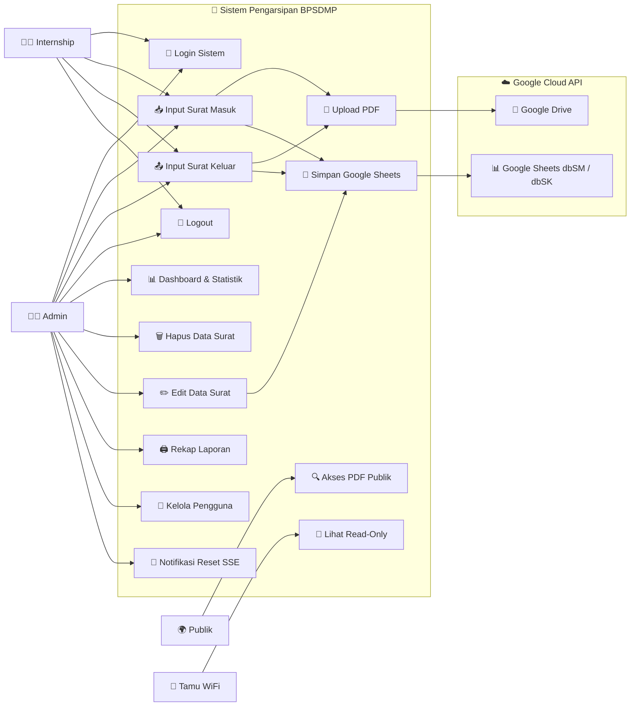
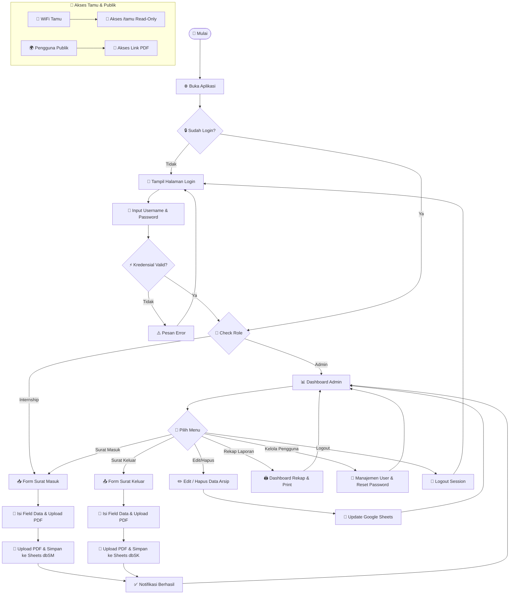
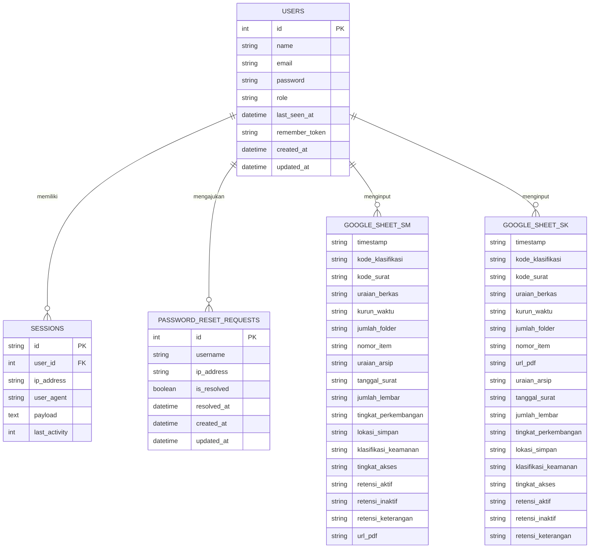

# 📂 Sistem Pengarsipan Digital Surat — BPSDMP

Aplikasi web berbasis **Laravel 13** untuk pengarsipan surat masuk dan surat keluar secara digital. Data arsip disimpan langsung ke **Google Spreadsheet** via Google Sheets API v4, file PDF disimpan di server lokal dan Google Drive.

---

## ⚡ Quick Start — Jalankan Pertama Kali (Mode 1-Pintu)

Setelah melakukan `git clone` pada PC server khusus, Anda **cukup menjalankan 1 berkas skrip master** tanpa perlu konfigurasi manual:

1. Buka folder proyek dan klik ganda berkas:
   ```cmd
   setup-and-run.bat
   ```
   *(atau jalankan `start-all.bat` untuk sesi berikutnya)*

2. Skrip master 1-Pintu akan secara otomatis mengeksekusi alur berikut:
   - 🔑 **UAC Elevation** — Meminta akses Administrator Windows otomatis
   - ⚡ **Service Laragon** — Menyalakan Apache & MySQL
   - 📝 **Environment** — Mengisi berkas `.env` & generate `APP_KEY`
   - 🗄️ **Database** — Membuat database `arsip_bpsdmp`, menjalankan migrasi & seed
   - 🌐 **Virtual Host** — Membuat VirtualHost Apache `kearsipan.local.conf`
   - 📌 **Hosts File** — Mendaftarkan domain `127.0.0.1 kearsipan.local` di `hosts` Windows
   - 🛡️ **Firewall** — Membuka Inbound Port 80 pada Windows Firewall
   - 🧹 **Storage & Cache** — Membersihkan temporary views, sessions, & cache/data (`storage:clean`)

3. Akses aplikasi melalui browser:
   - **Akses Staff / Admin**: `http://kearsipan.local/`
   - **Akses WiFi Tamu (Read-Only)**: `http://kearsipan.local/tamu`

---

## 🚀 Fitur Utama

| Fitur | Deskripsi |
|---|---|
| 🔐 **Autentikasi & RBAC** | Login aman dengan multi-role: `admin` & `internship` |
| 📥 **Surat Masuk** | Input data lengkap + upload PDF, tersimpan ke Google Sheets (`dbSM`) |
| 📤 **Surat Keluar** | Input data lengkap + upload PDF, tersimpan ke Google Sheets (`dbSK`) |
| ✏️ **Edit & Hapus** | Kelola data arsip langsung terintegrasi dengan Google Sheets (admin only) |
| 🔍 **Filter & Klasifikasi** | Pencarian & filter berdasarkan kode klasifikasi surat |
| 📊 **Dashboard & Rekapitulasi** | Statistik data arsip bulanan, tahunan, dan per klasifikasi (admin only) |
| 👥 **Manajemen Pengguna** | Admin dapat mereset password internship & menindaklanjuti permintaan reset |
| 🔔 **Notifikasi Realtime (SSE)** | Admin mendapat notifikasi realtime saat internship mengajukan reset password |
| 🌐 **Intranet Ready** | Akses di jaringan LAN/WiFi via domain `kearsipan.local` |
| 👀 **Mode Tamu (Read-Only)** | Halaman khusus WiFi tamu tanpa login untuk melihat arsip |
| 🔒 **Cybersecurity Layer** | Proteksi Formula Injection, CSP, Rate Limiting, & Session Protection |
| 🧹 **Task Scheduler** | Pembersihan otomatis file temporary setiap tengah malam |

---

## 🛠️ Tech Stack

| Lapisan | Teknologi |
|---|---|
| **Framework** | Laravel 13 (PHP 8.3+) |
| **Database** | MySQL / MariaDB (autentikasi & session) |
| **Penyimpanan Data** | Google Sheets API v4 (`dbSM` & `dbSK`) |
| **Penyimpanan File** | Server Lokal (`/uploads`) + Google Drive API |
| **Frontend** | Blade Templates + Vanilla CSS (Dark Mode) |
| **Web Server** | Apache via Laragon — Virtual Host `kearsipan.local` |
| **Real-time** | Server-Sent Events (SSE) untuk notifikasi reset password |

---

## 👥 Peran & Hak Akses

| Kemampuan | Admin | Internship | Tamu (WiFi) | Publik |
|---|:---:|:---:|:---:|:---:|
| Login | ✅ | ✅ | ❌ | ❌ |
| Input Surat Masuk | ✅ | ✅ | ❌ | ❌ |
| Input Surat Keluar | ✅ | ✅ | ❌ | ❌ |
| Edit / Hapus Surat | ✅ | ❌ | ❌ | ❌ |
| Dashboard & Rekap | ✅ | ❌ | ❌ | ❌ |
| Kelola Pengguna | ✅ | ❌ | ❌ | ❌ |
| Lihat Arsip (Read-Only) | ✅ | ✅ | ✅ | ❌ |
| Akses PDF Publik | ✅ | ✅ | ✅ | ✅ |

---

## 🗺️ Peta Rute (Routes)

### Publik
| Method | URL | Keterangan |
|---|---|---|
| `GET` | `/login` | Halaman login |
| `POST` | `/login` | Proses login *(throttle: 5 req/menit)* |
| `POST` | `/logout` | Proses logout |
| `POST` | `/password/request-reset` | Ajukan permintaan reset password *(throttle: 3 req/5 menit)* |
| `GET` | `/pdf/{type}/{filename}` | Akses file PDF publik |
| `GET` | `/image/{filename}` | Akses file gambar publik |

### Terautentikasi (Admin & Internship)
| Method | URL | Keterangan |
|---|---|---|
| `GET` | `/` | Daftar Surat Masuk |
| `POST` | `/arsip` | Simpan Surat Masuk baru |
| `GET` | `/surat-keluar` | Daftar Surat Keluar |
| `POST` | `/surat-keluar` | Simpan Surat Keluar baru |

### Admin Only
| Method | URL | Keterangan |
|---|---|---|
| `GET` | `/dashboard` | Dashboard & statistik |
| `GET` | `/dashboard/report` | Rekap laporan (printable) |
| `GET` | `/arsip/{rowIndex}/edit` | Form edit Surat Masuk |
| `PUT` | `/arsip/{rowIndex}` | Update Surat Masuk |
| `DELETE` | `/arsip/{rowIndex}` | Hapus Surat Masuk |
| `GET` | `/surat-keluar/{rowIndex}/edit` | Form edit Surat Keluar |
| `PUT` | `/surat-keluar/{rowIndex}` | Update Surat Keluar |
| `DELETE` | `/surat-keluar/{rowIndex}` | Hapus Surat Keluar |
| `GET` | `/admin/users` | Kelola pengguna |
| `POST` | `/admin/users/{user}/reset-password` | Reset password pengguna |
| `POST` | `/admin/password-reset-requests/{id}/resolve` | Tandai permintaan reset selesai |
| `GET` | `/sse/reset-requests` | Stream SSE notifikasi reset password |
| `GET` | `/api/reset-requests-version` | Polling fallback versi permintaan reset |

### Tamu WiFi (Read-Only, Tanpa Login)
| Method | URL | Keterangan |
|---|---|---|
| `GET` | `/tamu` | Daftar Surat Masuk (read-only) |
| `GET` | `/tamu/surat-keluar` | Daftar Surat Keluar (read-only) |

---

## 👤 Use Case Diagram



---

## 🔄 Flowchart Sistem



---

## 📐 Entity Relationship Diagram (ERD)



---

## 🔒 Keamanan (Security Layer)

Aplikasi dilengkapi dengan beberapa lapisan keamanan:

| Middleware | Fungsi |
|---|---|
| `AdminOnly` | Membatasi akses rute hanya untuk role `admin` |
| `InternalNetworkOnly` | Membatasi akses input/write hanya dari subnet jaringan internal |
| `GuestNetwork` | Membatasi `/tamu` agar hanya bisa diakses dari subnet tamu atau internal |
| `SecurityHeaders` | Menambahkan HTTP headers: CSP, X-Frame-Options, X-Content-Type-Options, dll. |
| `UpdateUserLastSeen` | Mencatat waktu terakhir user aktif (`last_seen_at`) |
| **Rate Limiting** | Login: maks 5 req/menit; Reset Password: maks 3 req/5 menit |
| **Formula Injection** | Sanitasi input spreadsheet untuk mencegah CSV/formula injection |
| **Session Protection** | Enkripsi session, expire on close, SameSite cookie |

---

## ⚙️ Konfigurasi Environment (`.env`)

Salin `.env.example` ke `.env` dan sesuaikan nilai berikut:

```env
# Aplikasi
APP_NAME="Arsip Surat BPSDMP"
APP_URL=http://kearsipan.local
APP_TIMEZONE=Asia/Makassar

# Kontrol Jaringan Intranet
INTRANET_ENABLED=true
INTERNAL_NETWORK_SUBNET=192.168.252.0/22   # Subnet staff/admin
GUEST_NETWORK_SUBNET=10.0.0.0/24           # Subnet tamu (read-only)

# Google API
GOOGLE_SHEET_ID=<id-spreadsheet-anda>
GOOGLE_SERVICE_ACCOUNT_JSON=storage/app/google-credentials.json
GOOGLE_DRIVE_FOLDER_ID=<id-folder-drive-anda>

# Database MySQL
DB_DATABASE=arsip_bpsdmp
DB_USERNAME=root
DB_PASSWORD=
```

> **Catatan**: Letakkan file `google-credentials.json` (Service Account key) di `storage/app/`.

---

## 🔒 Pemeliharaan & Jadwal Otomatis (Scheduler)

Aplikasi dilengkapi dengan **Laravel Task Scheduler** yang berjalan setiap pukul **00:00 (Tengah Malam)** untuk membersihkan berkas-berkas temporary:

- `storage/framework/views` — Compiled Blade Views
- `storage/framework/sessions` — File Session Usang
- `storage/framework/cache/data` — Subfolder Cache Data

Pembersihan manual dapat dilakukan kapan saja via terminal:
```bash
php artisan storage:clean
```

---

## 📁 Struktur Direktori Penting

```
project-magang/
├── app/
│   ├── Http/
│   │   ├── Controllers/
│   │   │   ├── Admin/UserController.php        # Kelola pengguna & reset password + SSE
│   │   │   ├── Auth/LoginController.php         # Login & logout
│   │   │   ├── Auth/PasswordResetController.php # Permintaan reset password
│   │   │   ├── ArsipController.php              # CRUD Surat Masuk
│   │   │   ├── SuratKeluarController.php        # CRUD Surat Keluar
│   │   │   ├── DashboardController.php          # Dashboard & rekap laporan
│   │   │   └── Controller.php                   # Base controller: KODE_MAP, sortByKlasifikasi, dll.
│   │   └── Middleware/
│   │       ├── AdminOnly.php
│   │       ├── InternalNetworkOnly.php
│   │       ├── GuestNetwork.php
│   │       ├── SecurityHeaders.php
│   │       ├── UpdateUserLastSeen.php
│   │       └── Concerns/
│   │           └── ChecksIpSubnet.php           # Trait bersama: validasi IP subnet CIDR
│   ├── Models/
│   │   ├── User.php
│   │   └── PasswordResetRequest.php
│   └── Services/
│       ├── GoogleDriveService.php               # Upload ke Google Drive
│       └── SheetsCache.php                      # Cache data Google Sheets
├── database/
│   ├── migrations/                              # Skema tabel MySQL
│   └── seeders/                                 # Data awal (user default)
├── routes/
│   ├── web.php                                  # Definisi semua rute web
│   └── console.php                              # Task scheduler (storage:clean)
├── storage/app/
│   └── google-credentials.json                  # (tidak di-commit) Service Account key
├── uploads/                                     # File PDF yang diupload
├── setup-and-run.bat                            # Skrip setup 1-Pintu (Windows)
└── start-all.bat                                # Skrip jalankan ulang (Windows)
```

---

## 🔧 Optimalisasi & Refaktor (Changelog Teknis)

Proyek ini telah menjalani audit dan optimalisasi komprehensif:

| # | Perubahan | File |
|---|---|---|
| 1 | Konsolidasikan `KODE_KLASIFIKASI_ORDER`, `KODE_MAP`, `sortByKlasifikasi()`, `applyKodeMapFallback()` ke base `Controller.php` | `Controller.php` |
| 2 | Ekstrak `mapDbsmRow()` & `fetchAndCacheDbsm()` → hilangkan duplikasi di `index()` & `indexGuest()` | `ArsipController.php` |
| 3 | Ekstrak `mapDbskRow()` & `fetchAndCacheDbsk()` → hilangkan duplikasi di `index()` & `indexGuest()` | `SuratKeluarController.php` |
| 4 | Buat `Trait ChecksIpSubnet` → hilangkan duplikasi `ipInSubnet()` di dua middleware | `Concerns/ChecksIpSubnet.php` |
| 5 | Ganti `@unlink()` dengan `safeDeleteFile()` → tambah logging saat file gagal dihapus | `Controller.php` |
| 6 | Tambahkan relasi `user()` BelongsTo pada `PasswordResetRequest` model | `PasswordResetRequest.php` |

---

## 📄 Lisensi

Proyek ini dikembangkan sebagai bagian dari **program magang** di **BPSDMP** dan bersifat internal.
